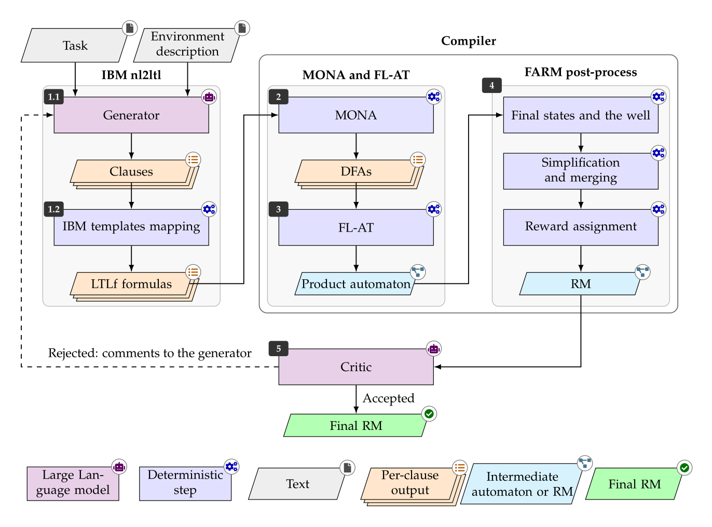
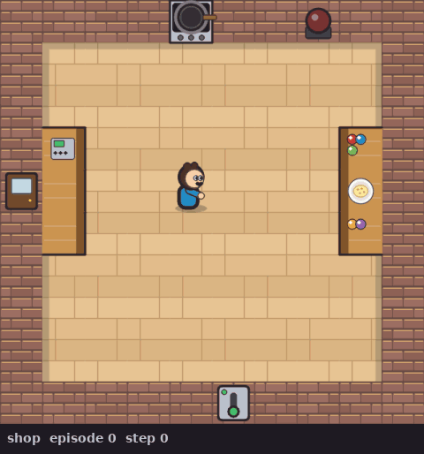
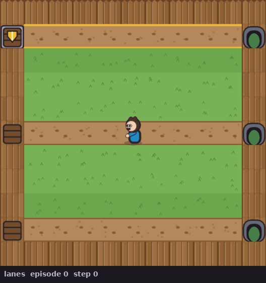

# FARM (`schema-rm-rl`)

FARM turns a task written in plain language into a **Reward Machine** (RM): a small automaton
that tells a reinforcement-learning agent what it has to do and when it gets a reward.

You give it two things:

- **A task**, such as *"Reach the goal, ideally without ever losing the key."*
- **An environment description**, a Markdown file that says what can happen in the environment.

It gives back an RM. A language model only reads the task. The RM itself is built by formal
tools, so nobody writes its states or rewards by hand.

This repository is the code of the master's thesis in [`paper/`](paper/). It also holds the
ARM-FM baseline that FARM is compared with, and the code to train agents with either RM.

## How it works



| Step | What happens | Done by |
| --- | --- | --- |
| 1 | The **generator** splits the task into **clauses**: a template, the propositions it applies to, and a hard or soft priority. Each clause becomes an LTLf formula. | A language model and the templates of IBM nl2ltl |
| 2 | Each formula is compiled into an automaton (DFA). | MONA, called by FL-AT |
| 3 | The automata are joined into one. | FL-AT |
| 4 | The post-process sets the final states, simplifies the automaton and assigns the rewards. | This repository |
| 5 | The **critic** checks the RM against the task. If it rejects it, the generator tries again. | A second language model |

Steps 2 to 4 call no language model. More detail: [readme/pipeline.md](readme/pipeline.md).

## Quick start

**1. Install.** On Linux or macOS:

```bash
git clone --recurse-submodules https://github.com/MiquelGomezCorral/TFM-schema-rm-rl.git
cd TFM-schema-rm-rl
conda create --name RM_RL_env python=3.13 -y
conda activate RM_RL_env
uv pip install --python "$CONDA_PREFIX/bin/python" --torch-backend auto -r requirements.txt
uv pip install --python "$CONDA_PREFIX/bin/python" -e .
```

You also need [MONA](https://www.brics.dk/mona/) on your `PATH`, so that `mona -v` works.
Full steps: [readme/install.md](readme/install.md).

**2. Choose a language model.** Copy `example.env` to `.env` and fill in one provider:

```dotenv
LLM_PROVIDER=opencode
OPENCODE_API_KEY=...
OPENCODE_MODEL=...
```

The other providers (OpenAI, Antigravity, a local server) are in
[app/src/engines/README.md](app/src/engines/README.md).

**3. Generate an RM.**

```bash
python app/main.py generate-rm \
  --environment experiments/benchmark/envs/minigrid-doorkey/environment.md \
  --task "Reach the goal, ideally without ever losing the key." \
  --step-limit 640 \
  --output careful-key.rm
```

The RM is written to `outputs/careful-key.rm`. For this task it should look like this:

```text
REWARD_MACHINE:
STATES: u0, u1
INITIAL_STATE: u0
FINAL_STATES: u1
DEFAULT_REWARD: 0
TRANSITION_FUNCTION:
(u0, !at_goal&key_lost) -> u0
(u0, at_goal&!key_lost) -> u1
(u0, at_goal&key_lost) -> u1
REWARD_FUNCTION:
(u0, !at_goal&key_lost, u0) -> -1
(u0, at_goal&!key_lost, u1) -> 11
(u0, at_goal&key_lost, u1) -> 10
```

Reaching the goal finishes the task and pays 11. Losing the key costs 1 each time, and it does
not stop the agent from finishing, because the task only says "ideally".

Add `--svg` to also get a drawing of the RM in `outputs/svgs/`.

## What else you can do

| I want to | Use | Guide |
| --- | --- | --- |
| Generate RMs with more options | `python app/main.py generate-rm` | [readme/generate-rm.md](readme/generate-rm.md) |
| Use a web page instead of the terminal | `python app/app.py` | [readme/web-ui.md](readme/web-ui.md) |
| Describe a new environment | An `environment.md` file | [readme/environment-files.md](readme/environment-files.md) |
| Train an agent with an RM | `python app/main.py train-rl` | [readme/training.md](readme/training.md) |
| Run the whole experiment: both methods, training, testing and comparison | Several commands | [docs/EXPERIMENTS.md](docs/EXPERIMENTS.md) |
| Give each RM state an embedding | A local embedding server | [readme/embeddings.md](readme/embeddings.md) |

### The web page

```bash
PYTHONPATH=app python app/app.py
```

Then open <http://127.0.0.1:8050>. Paste or upload the environment description, write one or
more tasks, and the page shows each step of the pipeline, the RM text and its graph.

### Two of the environments

| Shop | Zombie garden (Lanes) |
| --- | --- |
|  |  |
| The agent takes orders, fetches food from the pantry and serves it at the counter. When the siren rings it must silence it. | Zombies walk down three lanes. The top lane must never let one through. The agent should also spare the side lanes and the plants. |

## What is in each folder

| Folder | What it holds |
| --- | --- |
| `app/` | The code. `main.py` has the commands, `app.py` the web page, `src/` the rest |
| `app/src/engines/` | The connection to each language-model provider |
| `dependencies/` | The forks of IBM nl2ltl and FL-AT that FARM uses (git submodules) |
| `experiments/` | Environment descriptions, tasks and the benchmark |
| `configs/` | Training settings, one YAML file per run |
| `docs/` | Design notes and the experiment guide |
| `paper/` | The thesis |
| `readme/` | The guides linked from this page, and their images |
| `outputs/`, `logs/` | What the commands write |

## Limits and licence

- **The clauses depend on the language model.** A small model sometimes picks a weak template
  or adds a clause that the task did not ask for. An RM that the critic accepts is not proven
  to match the task.
- **The model must support structured output.** With a model that does not, the provider
  returns an error. Nothing is retried with another model.
- **Licence.** This repository is under the MIT licence ([LICENSE](LICENSE)). The original
  FL-AT repository declares no licence, and the
  [request for one](https://github.com/Jamidd/Flat/issues/1) is still open.
