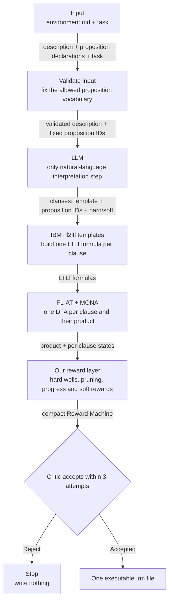
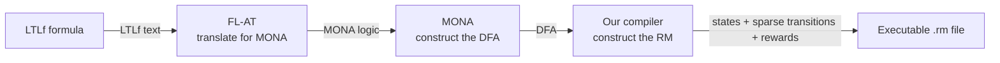

# schema-rm-rl

`schema-rm-rl` converts environment Markdown and critic-validated natural-language tasks into
formally compiled Reward Machines, or complete ARM-FM bundles with labeling functions, state
descriptions, embeddings, and policy checkpoints. Compiler mode remains bounded to the
supported clause language; baseline mode reconstructs the paper's direct RM generation.

To run the full experiment on an environment (describe it, generate both RMs, train the no-RM,
compiler-RM and paper-RM agents, test them on unseen maps and compare them), follow
[docs/EXPERIMENTS.md](docs/EXPERIMENTS.md).

## Quick start

On Linux or macOS, clone the repository and run the bootstrap script:

```bash
git clone --recurse-submodules https://github.com/MiquelGomezCorral/TFM-schema-rm-rl.git
cd TFM-schema-rm-rl
conda create --name RM_RL_env python=3.13 -y  # only when the approved env is absent
conda activate RM_RL_env
uv pip install --python "$CONDA_PREFIX/bin/python" --torch-backend auto -r requirements.txt
uv pip install --python "$CONDA_PREFIX/bin/python" -e .
```

`requirements.txt` is authoritative for the existing Python 3.13 `RM_RL_env` Conda
environment. The ARM-FM runtime uses pinned Torch, Stable-Baselines3 (replay buffers),
Transformers, and MiniGrid releases; do not create a second environment.

The legacy `setup.sh` remains useful for the compiler-only workflow: it initializes
submodules, installs the project, and provisions MONA. Its `.venv` should not be used
for ARM-FM training or embedding commands.

`train-rl` supports registered MiniGrid ids through the `minigrid` adapter; another
environment family needs its own adapter (see [Train a policy](#train-a-policy)).
Domain-specific integrations (XLand-MiniGrid, Craftium, Meta-World) were removed and will
be rebuilt as needed; MiniGrid stays because the compiler's labeling stage targets it.
Choose a provider in `.env` and set its model. For OpenCode, set `OPENCODE_API_KEY` and
keep or change the configured model.

### Optional: Antigravity (AGY)

AGY is optional and is not installed by `setup.sh`. To use an Antigravity Google
subscription, install it with the [official macOS/Linux command](https://antigravity.google/docs/cli/install/),
then run `agy` once and complete the login:

```bash
curl -fsSL https://antigravity.google/cli/install.sh | bash
agy
agy models
```

Set the provider and one model slug returned by `agy models`:

```dotenv
LLM_PROVIDER=antigravity
ANTIGRAVITY_MODEL=<slug from agy models>
```

Antigravity uses its local cached account session and subscription quota, so it needs no
API key. The application starts `agy` in non-interactive mode with no tools and consumes
the subscription quota for each request. Its own CLI may retain account/session history
independently of this application's logs. Verify the local installation without calling
an LLM:

```bash
mona -v
python app/main.py --help
```

Jupyter support is optional:

```bash
.venv/bin/python -m pip install ipykernel
.venv/bin/python -m ipykernel install --user --name=RM_RL_env --display-name "Python (RM_RL_env)"
```

The pinned `nl2ltl` fork removes its obsolete mandatory OpenAI pin while retaining
`pylogics`. The pinned FL-AT fork exposes the compiler API used here.

### Editing a dependency fork

Submodules are normally checked out at detached commits. Before editing one, switch to
the fork's default branch and add the original repository as `upstream`:

```bash
cd dependencies/nl2ltl
git switch main
git pull --ff-only origin main
git remote add upstream https://github.com/IBM/nl2ltl.git

cd ../Flat
git switch master
git pull --ff-only origin master
git remote add upstream https://github.com/Jamidd/Flat.git
```

In both submodules, `origin` is the maintained fork and `upstream` is the original
project. Commit and push dependency changes on `main` or `master`, then return to the
parent repository and commit the updated submodule gitlink.

## Install MONA from source

`setup.sh` installs MONA through an available package manager and falls back to the
source route below if needed.

Download MONA from <https://www.brics.dk/mona/download.html>, unpack the source, and
follow its source build:

```bash
./configure --prefix="$HOME/.local"
make
make install
export PATH="$HOME/.local/bin:$PATH"
mona -v
```

The `mona` executable must be on `PATH`. Compilation fails with a clear error when it
is unavailable. System build tools and the dependencies listed by MONA may need to be
installed first.

## Optional: local embeddings (llama-server)

Only needed for compiler runs with `--embeddings` or the web UI's **Local state
embeddings** option. The app sends each state description to a local
[llama.cpp](https://github.com/ggml-org/llama.cpp) `llama-server` running the
`nomic-embed-text` model. Without that server the Embeddings stage fails with
`Connection refused`.

**1. Install llama-server.** Download a prebuilt binary from the
[llama.cpp releases](https://github.com/ggml-org/llama.cpp/releases), or build it. Drop
`-DGGML_CUDA=ON` if you have no NVIDIA GPU:

```bash
git clone https://github.com/ggml-org/llama.cpp
cd llama.cpp
cmake -B build -DGGML_CUDA=ON
cmake --build build --config Release -j
ls build/bin/llama-server
```

**2. Get the model.** Pull it with [Ollama](https://ollama.com/download). The default
`embedding_revision` in `app/src/config/config.py` is the hash of this exact file:

```bash
ollama pull nomic-embed-text
```

**3. Find the model path.** Ollama stores the model as a plain GGUF file, which
llama-server can read directly. The `FROM` line gives its path:

```bash
ollama show nomic-embed-text --modelfile | grep '^FROM'
# FROM /usr/share/ollama/.ollama/models/blobs/sha256-970aa74c...
```

**4. Fill in `.env`.** Use both paths and pick a port:

```dotenv
LLAMA_SERVER_PORT=8934
LLAMA_SERVER_BIN=/path/to/llama.cpp/build/bin/llama-server
LLAMA_SERVER_MODEL=/usr/share/ollama/.ollama/models/blobs/sha256-970aa74c...
```

**5. Start the server.** `python app/app.py` prints the exact command at startup, built
from these values. Run it in a second terminal and keep it open while the app runs. The
app calls `http://127.0.0.1:$LLAMA_SERVER_PORT/v1/embeddings`, so both always use the same
port. To check it:

```bash
curl -s localhost:8934/v1/embeddings -H 'Content-Type: application/json' \
  -d '{"model":"nomic-embed-text","input":"test"}' | head -c 100
```

Ollama only supplies the file. The app never calls Ollama's own server on port 11434.

## Environment Markdown

Normal Markdown prose is allowed, but exactly one strict proposition section is
required. Every nonblank line in it must use this shape:

```markdown
## Propositions
- `p1`: Passenger 1 entered the taxi.
- `d1`: Passenger 1 was delivered.
```

Identifiers must match `^[a-z_][a-z0-9_]*$`, be unique, and cannot be `true` or
`false`. Validation errors include the offending line. See
`examples/multitaxi/environment.md` for the transition-based MultiTaxi propositions.

Environments used for labeling or training need an `environment-code.md` next to `environment.md`,
with a `## Labeling API` section listing what the labeling code may read from the live environment.
`environment.md` holds the facts only; the steps that write code (the `generate-larm --mode arm-fm`
generator and the labeling stage) load both files as one text, while the clause generator and the
critic read the facts alone. See
[docs/ENVIRONMENT_AUTHORING.md](docs/ENVIRONMENT_AUTHORING.md) and
[docs/EXPERIMENTS.md](docs/EXPERIMENTS.md#1-describe-the-environment).

## Generate a Reward Machine

Configure one supported provider in `.env`. OpenCode uses:

```bash
LLM_PROVIDER=opencode
OPENCODE_API_KEY="..."
OPENCODE_BASE_URL=https://opencode.ai/zen/v1
OPENCODE_MODEL=nemotron-3.5-lightning-free
```

Antigravity uses the cached Google subscription instead of an API key:

```bash
LLM_PROVIDER=antigravity
ANTIGRAVITY_MODEL=<slug from agy models>
```

Authenticate once with `agy` interactively before running the command. The provider is
invoked headlessly with schema-constrained JSON output and no permission-enabled tools.

Run the compiler from the repository root:

```bash
python app/main.py generate-rm \
  --environment examples/multitaxi/environment.md \
  --task "Eventually deliver passengers 1 and 2" \
  --task "Deliver passenger 1 before passenger 2" \
  --output multitaxi.rm \
  --overwrite
```

Each task may contain several ordinary-language requirements. The model normalizes
them into conjunctive clauses, each an IBM DECLARE template with declared propositions and a
`hard` or `soft` priority; `soft` comes only from explicit preference language ("if possible",
"preferably", ...).

The command displays timed progress for every task attempt and stage. One critic runs by
default after the Reward Machine is built; `--no-critic` disables it for a controlled fallback
run, prints a warning, and then accepts the compiler's first result for each task. Each task
has at most three attempts, and no output is written unless every task is accepted. The stages
are structured proposal generation, DECLARE/LTLf materialization, FL-AT/MONA DFA compilation,
Reward Machine construction (FL-AT's product plus the reward layer), the critic, state
descriptions, and optional labeling and embeddings. State descriptions are written by default;
`--no-state-descriptions` skips that stage, and `--labeling` and `--embeddings` require it.
A soft `Absence`, `Precedence`, `ChainResponse` or `NotCoExistence` costs `-0.5` at every new break
by default (the recurrent soft penalty); `--no-recurrent-soft-penalty` charges it once per
episode. The setting is written to the run log, the step trace, the steps report and a compiler
bundle's manifest.
Compile warnings (a rule-only task with no final state, soft clauses without reward effect)
appear in the log and the web result.

Each accepted task's clauses are compiled through MONA and composed into one
task-specific Reward Machine. Separate tasks are never composed. `--output`
is a file name, not a path; files are always written under `Configuration.OUTPUT_PATH`.
Multiple tasks number the stem, so the example writes `multitaxi-1.rm` and
`multitaxi-2.rm` under that directory. All target paths are
checked before compilation, and existing files are rejected unless `--overwrite` is
supplied. Add `--svg` to write one SVG graph per accepted Reward Machine into
`outputs/svgs`, or into `--svg-dir <directory>`; existing graphs are rejected unless
`--overwrite` is supplied as well.

Progress logs use `[total 12.345s | step 1.234s]` prefixes. Total time is measured
from run start; step time is measured since the preceding progress entry. Every run writes
the same plain-text records to a unique `logs/run-<UTC timestamp>.log` file. The log path
is printed first, and the file is retained until you delete it manually. It includes the
validated proposal JSON, critic verdicts, each LTLf clause, complete DFA data, and the
serialized Reward Machine. Credentials, environment variables, request headers, full
prompts, and raw provider responses are not written.

Compiler output uses the ARM-FM text format with separate transition and reward
functions, matching experiment bundles. Internal compiler states remain numeric;
text uses `u0`, `u1`, and so on. For example, a
hard `d1`-before-`d2` machine has one success final state and a declared rejecting
sink:

```text
REWARD_MACHINE:
STATES: u0, u1, u2, u3
INITIAL_STATE: u0
FINAL_STATES: u3
DEFAULT_REWARD: 0
TRANSITION_FUNCTION:
(u0, !d1 & d2) -> u1
(u0, d1 & !d2) -> u2
(u0, d1 & d2) -> u1
(u2, !d1 & d2) -> u3
(u2, d1 & d2) -> u3
REWARD_FUNCTION:
(u2, !d1 & d2, u3) -> 1.1
(u2, d1 & d2, u3) -> 1.1
```

Missing transitions are zero-reward self-loops. Only state-changing transitions and
necessary nonzero-reward transitions are emitted, using propositions from that
task only. Every transition is listed in `TRANSITION_FUNCTION`; only nonzero rewards
are listed in `REWARD_FUNCTION`. Imports accept explicit self-loops and `else` rows;
an `else` row applies only when no ordinary guard matches and may lead to another
state. The rejecting sink has no explicit outgoing rows, so it remains there through
the same implicit self-loop rule. ARM-FM baseline generation and published artifacts
retain their existing format and explicit `else` conventions. Earlier numeric
semicolon files must be regenerated to use the new compiler import format.

The reward layer computes every reward from the clause DFAs
(`docs/COMPILER_REWARD_DESIGN.md`). Progress shaping pays `0.1` per step closer to the goal and
finishing adds `+1.00`. A hard violation enters the rejecting sink (`-1.00`). A soft clause costs
`-0.5` when it breaks (at every new break with the recurrent soft penalty, once without it), and
`-0.5` more if a soft clause is still pending at the finish (a soft goal, or an open obligation
such as `ChainResponse`'s); keeping it earns nothing. A machine with a loop whose rewards add up
above 0 is rejected.

## Train a policy

`train-rl` trains one DQN run, with or without a Reward Machine, following ARM-FM Alg. 1
and Table 5. Each run is one YAML file under `configs/`; the seed comes only from the CLI:

```bash
python app/main.py train-rl --config minigrid-unlock-pickup/rm-task1-symbolic.yaml --seed 1
```

The learner is adapted from CleanRL's MIT `dqn_atari.py` (upstream SHA in
`app/src/arm_fm/dqn.py`) and uses Stable-Baselines3 replay buffers. `reward_source` picks the
reward: `rm` (default) the RM reward only, `both` environment + RM reward, `env` no RM at all
(plain sparse-reward DQN). With an RM the run loads `bundle` (RM, labeling, state embeddings):
each step evaluates the labeling, makes one RM transition, and feeds the Q-network the embedding
of the current RM state. The episode ends when the environment ends it, when the RM enters a
declared final or rejecting state, or at the time limit, which adds -0.5 to the RM reward.
`labeling_bundle` can take `labeling.py` from another bundle with the same propositions.
RM configs need their local bundle under `outputs/bundles/`, which is gitignored, and bundle
paths are relative to the repository root, so run `train-rl` from there.

The configs in `configs/minigrid-unlock-pickup/` cover:

- **Smoke runs (`smoke-*.yaml`):** 20k steps to check the pipeline, for the symbolic 7x7
  view, 84x84 pixels, and the procedural layout.
- **Full runs:** `sparse-symbolic`, `rm-task1-symbolic` and `rm-task4-symbolic` use the
  Table 5 values and the authors' 300k-step budget.

`layout: fixed` resets every episode to `layout_seed` (default: the run seed);
`layout: procedural` evaluates on held-out seeds from `eval_seed_base`. Each run writes
`outputs/runs/<exp_name>/seed<seed>-<UTC time>-<pid>/` with `config.yaml`, `episodes.csv`,
`eval.csv`, `train.csv`, `summary.json`, and `q_network.pt`. To compare seeds or configs,
start several `train-rl` processes side by side; each gets its own folder.

## Local web UI

Install the declared dependencies in the Python 3.13 environment, then start the local
Dash interface from the repository root:

```bash
uv pip install --python "$CONDA_PREFIX/bin/python" -r requirements.txt
uv pip install --python "$CONDA_PREFIX/bin/python" -e .
PYTHONPATH=app "$CONDA_PREFIX/bin/python" app/app.py
```

The UI uses the provider configured in `.env` (`LLM_PROVIDER`, its matching model, and
provider-specific credentials or base URL). Antigravity uses the cached `agy` account
session and requires no API key. The UI does not accept or display credentials. MONA must
be installed separately and available on `PATH` (or configured through
`MONA_EXECUTABLE`), just as for the CLI.

Upload a UTF-8 environment Markdown file or paste it into the editor, add one or more
tasks, and provide one base output filename. Uploading a tasks manifest such as
`examples/arm-fm/minigrid-doorkey/tasks.json` (`env`, `env_description`, `tasks`) instead
reads the referenced Markdown, fills every task, and names the output after `env`. The optional
Code file box takes `environment-code.md` (upload or paste); the labeling option needs it and refuses
to start without it. The UI validates each task automatically with the critic. Multiple tasks
retain the CLI's numbered output behavior under `Configuration.OUTPUT_PATH`, for example `batch-1.rm`, `batch-2.rm`, and
`batch-3.rm`. Each completed file is shown with its exact path, serialized text, and
read-only state graph.

Run status opens on the Steps tab. It shows the current task, attempt, six stage states,
durations, and the latest retry reason. Blue means running, green completed, gray pending
or skipped, and red failed; every state also has a text label. The Log tab retains the
complete timed multiline records. With multiple tasks, previous/next buttons and up to
five task dots navigate the sequential run; the selection follows the active task only
when you were viewing the previous active task.

**Stop generation** asks once, then cancels after the current provider request returns; the
current task is discarded, finished tasks stay in the log only, and nothing is written.

This is a local single-run interface: only one run may be active at a time, jobs are not
persisted, and the UI does not provide overwrite controls, authentication, or multi-user
isolation.

## Limitations and licensing

- Clause choice depends on the generator model: the small flash models sometimes pick a weak
  template or add an unrequested clause, and a critic acceptance does not prove the clause set
  matches the task.
- Structured output requires a compatible provider model. An unsupported model is an
  API or CLI error and is not silently retried or downgraded.
- The upstream FL-AT repository does not declare a license. Its public adaptation fork
  is maintained at the project owner's accepted publication risk while the
  [license request](https://github.com/Jamidd/Flat/issues/1) remains unresolved.

## How the pipeline uses the formal tools



Input validation is not another interpretation step. It only checks that the Markdown
contains one valid proposition section, that proposition IDs are unique and safe for
the formal tools, and that later stages can use only that fixed vocabulary. This stops
the LLM from inventing events that the environment cannot emit.

There is only one NLP step in the current pipeline. The configured OpenCode, OpenAI, or
Antigravity model reads
the task and chooses constrained clauses, proposition IDs, and inferred priorities. IBM
`nl2ltl` is not running a second language model here: we use its deterministic DECLARE
template classes to turn each chosen clause into a `pylogics` LTLf formula. The LLM
does not generate LTLf, automaton states, transitions, numeric rewards, or output files.
Everything between the LLM answer and the critic is deterministic code and formal compilation.

The main ownership boundary is: **FL-AT and MONA compile each LTLf formula into a DFA and build
their product; `schema-rm-rl`'s reward layer turns that product into the executable Reward
Machine.** The pipeline calls FL-AT's `compile_dfa()` per clause and its `automatas_to_rm()`
product, which the fork extends to return each product state's per-clause DFA states. Design,
decisions and sources: `docs/COMPILER_REWARD_DESIGN.md`.

| Tool | What this project uses | What this project does not use, and why |
|---|---|---|
| IBM `nl2ltl` | All 8 DECLARE templates (`Existence`, `ExistenceTwo`, `Absence`, `RespondedExistence`, `Response`, `Precedence`, `ChainResponse`, `NotCoExistence`), built from its template classes, and their `to_ltlf()` formulas. | Its GPT and Rasa engines and filters: this project has its own schema-constrained engine and critic. Its grounding helper: `ground_notcoexistence` builds `NotCoExistence(b, b)`. PPLTL is unused because FL-AT receives LTLf. |
| FL-AT | The LTLf lexer, parser, translation to MONA logic, MONA process invocation, DFA output parser (`flat_tool.compile_dfa()`), and the synchronous product of clause DFAs (`automatas_to_rm()`, plus the fork's `state_tuples`). | PDDL3, PLTL, and regular-expression inputs; FL-AT's old CLI, its rewards and accepting set (they repeat rewards every accepting step), and its RM serializer. |
| `schema-rm-rl` | Environment parsing, LLM request validation, the bounded critic, LTLf serialization, the reward layer (per-clause satisfied/pending/violated labels, hard wells, pruning, longest-path progress shaping, soft penalties, and the re-arming of a broken soft rule when the recurrent soft penalty is on), and RM serialization. | It does not invent formal automaton topology; MONA and FL-AT build the DFAs and their product. |

Every pattern uses IBM's own formula. Hard and soft never change a formula: soft clauses change
rewards (a penalty at every new break, or once with `--no-recurrent-soft-penalty`, and a penalty
on the finishing edge for a soft clause still pending) and, with the recurrent soft penalty on,
re-arm a broken soft rule, while a hard violation leads to a rejecting well and a pending hard
obligation blocks finishing.

## MONA's role

MONA is a formal logic compiler and decision procedure, not an AI model. FL-AT
translates an accepted LTLf formula into MONA's logic, and MONA constructs the
deterministic finite automaton that recognizes traces satisfying that formula.



After MONA runs, the modified FL-AT adapter parses its DFA text and removes a proven
event-ignoring preamble when present. It then passes the parsed DFA to our RM compiler.

The local MONA source contains several subsystems:

| MONA component | Purpose in MONA | Use in this project |
|---|---|---|
| `Front/` | Parses and processes logical formulas. | Used indirectly through the `mona` executable. |
| `BDD/` | Represents Boolean conditions efficiently. | Used internally by MONA. |
| `DFA/` | Builds and manipulates automata over finite strings. | This is the automaton output the pipeline needs. |
| `GTA/` | Builds tree automata. | Not used because the pipeline handles finite event traces, not trees. |
| `Lib/` | Provides supporting automata operations and output utilities. | Used only as internal support for the executable. |

MONA does not read natural language, call an LLM, select propositions, assign rewards,
write the final RM format, or train an RL agent. Its responsibility is narrower: given
the formal meaning of an accepted task clause, produce the corresponding deterministic
automaton. FL-AT invokes it in `dependencies/Flat/LTLf/Translator.py`, and this project
then converts the returned DFA into the compact Reward Machine consumed by the TFM
runtime.
