# Appendix: what each template means, hard, soft and recurrent soft

For each of the eight IBM DECLARE templates, this appendix says what the clause means and what its
hard, soft and recurrent soft versions do to the reward, with traces for the cases that confuse
most. Every trace number comes from the real compiler and runtime. `check/clause_semantics.py`
compiles each machine, walks each trace through the runtime on the reloaded RM text, and writes
`check/traces.txt`; the tables below are pasted from that file, and the script fails if a pasted
table differs from it. The design is in the
[recurrent soft rules note](../recurrent-soft-rules/README.md) and in
[`COMPILER_REWARD_DESIGN.md`](../../COMPILER_REWARD_DESIGN.md).

Contents: [Notation](#notation) · [Scope](#scope) · [Hard, soft and recurrent soft](#hard-soft-and-recurrent-soft) ·
[The eight templates at a glance](#the-eight-templates-at-a-glance) ·
[1 Existence](#1-existence) · [2 ExistenceTwo](#2-existencetwo) · [3 Absence](#3-absence) ·
[4 RespondedExistence](#4-respondedexistence) · [5 Response](#5-response) · [6 Precedence](#6-precedence) ·
[7 ChainResponse](#7-chainresponse) · [8 NotCoExistence](#8-notcoexistence) · [Rerun](#rerun)

## Notation

- `x` and `y` are the template's first and second proposition, in the template's own argument order.
- A trace has one token per step. A token lists what is true at that step: `x`, `y`, or `xy` for
  both in the same step; `-` means neither. In the tables with a goal, `g` is the goal proposition
  `at_goal`. DoorKey ends the episode on the step that reaches the goal
  ([`environment.md:13`](../../../examples/arm-fm/minigrid-doorkey/environment.md)), so no step
  follows `g` there, and a hard run with the rule still open ends at `g` unfinished. Rows and
  sentences with steps after `g` are marked "machine only": they show the machine and not a DoorKey
  episode. A trace is a sequence of abstract valuations: it shows what the machine does, also for
  valuations DoorKey never produces. The text says where DoorKey rules a trace out.
- A **charge** is the −0.5 a soft rule pays when it breaks: the step where the rule goes from not
  broken to broken in the machine's own product. The other rewards are constants too (see
  `traces.txt`): well −1, completion +1, progress 0.1 per step closer to the final (with no final, to
  the states where no rule is waiting for an answer), and −0.5 on the finishing edge for a soft rule
  still open.
- A table cell reads `state, reward`: the RM state after the step and the reward of that step.
  `(well)` and `(final)` mark the step where the episode ends, and the rows after it show `—`. A
  hard trace therefore stops at the step the episode ends.
- Each template has one illustrative DoorKey task, with the propositions of the template catalog
  (`has_key`, `door_open`, `key_lost`, `at_goal`). The first column says which is `x` and which is
  `y`.

| Template | DoorKey rule | `x` | `y` |
|---|---|---|---|
| Existence | `has_key` is true at least once | `has_key` | |
| ExistenceTwo | `door_open` is true at two different steps | `door_open` | |
| Absence | `key_lost` is never true | `key_lost` | |
| RespondedExistence | if `door_open` ever happens, `has_key` also happens at some time, before, with or after it | `door_open` | `has_key` |
| Response | every time `has_key` happens, `door_open` happens on that step or later | `has_key` | `door_open` |
| Precedence | `door_open` does not happen before `has_key` has happened | `has_key` | `door_open` |
| ChainResponse | every time `has_key` happens, `door_open` happens on the very next step | `has_key` | `door_open` |
| NotCoExistence | `has_key` and `key_lost` never both happen during the episode | `has_key` | `key_lost` |

DoorKey facts used below come from
[`environment.md`](../../../examples/arm-fm/minigrid-doorkey/environment.md). `has_key` and
`door_open` are conditions that stay true while they hold; `key_lost` is an event, true for one
step after the key is dropped with the door closed (line 24).

## Scope

**What we do.** The eight templates are the DECLARE set of IBM `nl2ltl`, used as IBM defines them:
each formula is IBM's `to_ltlf()`
([`task-and-rm-identity.md:27`](../../decisions/arm-fm/task-and-rm-identity.md)). MONA turns the
formula into a DFA, and the DFAs of all clauses are combined into one Reward Machine. Hard, soft
and recurrent change the rewards, with one change to a clause's own DFA: the re-arm. The product of
the clause DFAs then gets the compiler's hard passes: violations of a hard rule go to one well,
"final" is dropped where a hard rule is not satisfied, states with no way left to a final go to the
well, and unreachable states are pruned
([cleanup passes](../../COMPILER_REWARD_DESIGN.md#cleanup-passes-in-order)).

**What we do not do.** We do not change a template's formula or what counts as a break, add states
to a clause's DFA, add templates, or add counters. The re-arm is the one change to a clause's DFA,
and it does change edges: with recurrent on, the broken-for-good state of a soft rule drops its own
edges and takes copies of the start state's edges (an edge that would enter a broken state loops
instead). That is the only edge change to a clause's DFA. It touches only that one state, it adds no
state, and the labels (pending, satisfied, violated) still come from the original DFA. It changes
what happens after a break, since the rule watches again, and not what counts as one. Hard rules and
recurrent off keep MONA's clause DFA unchanged. The hard passes follow from the DFA labels: they
only redirect, unmark or prune, and they add no formula and no new way to break or keep a rule.
Many intuitive variants are sensible rules for an agent, but each is a different formula, so a
different template and not a variant of these eight. Building them would have meant generating new
templates, which this work does not aim at. Any edge of a clause's own DFA other than the re-arm
comes from a new formula. Each subsection ends with a "What it does not mean" part: the readings a reader may
expect, with the formula each would need. Where that formula compiles through the same MONA path,
its machine is walked next to the real one (the formulas are in `check/traces.json`).

**Future work.** Extending the template set beyond IBM's eight.

**For the paper's pipeline section** (the paper text is not in this repository; this paragraph is
ready to quote). Limiting the work to IBM's eight templates is a decision taken from IBM's tool and
followed here. For these eight templates, each was examined hard, soft and recurrent soft, with the
re-arm through the DFA's broken-for-good state, and the work stops there, since going further means
new templates. Extending the set is future work.

## Hard, soft and recurrent soft

**Hard.** The agent cannot finish the task with the rule broken. When the break cannot be repaired
(Absence, Precedence, ChainResponse, NotCoExistence), the run moves to the well: reward −1, and the
episode ends. When it can be repaired, because a promised event is still missing (RespondedExistence,
Response), the episode goes on and the final state stays out of reach until the repair. The script
checks both: for the four irreparable templates the hard well comes at the step of the first soft
charge, and a repairable rule alone never reaches the well.

**Soft.** The rule never ends the episode and never keeps the agent from finishing. A break costs
−0.5 (a charge). A rule still open at the finishing step, a promise not kept or a goal not reached,
costs −0.5 once on the finishing edge.

**Recurrent soft (the default).** An LTLf formula gives one verdict per trace: it says whether the
rule was broken, not how often. So one charge per episode would let an agent break a preference
fifteen times for the price of once. A rule whose DFA has a "broken for good" state is re-armed: the broken state takes the start
state's edges, the rule watches again from the next step, and every new break charges −0.5. A step
that breaks the rule again while it is still broken is free. Only Absence, Precedence,
ChainResponse and NotCoExistence have such a state. With the switch off, the rule charges once per
episode. The reasons are in the [recurrent soft rules note](../recurrent-soft-rules/README.md).

**Alone, and with a goal.** The traces use the template alone: exactly one clause and no goal.
A hard Existence or ExistenceTwo alone is the goal itself. Every other machine alone has no final,
so progress aims at the states where no rule is waiting for an answer (design:
[Rewards](../../COMPILER_REWARD_DESIGN.md#rewards)). That pays 0.1 per step closer and costs 0.1 per
step away. Soft Existence and ExistenceTwo get +0.1 for each `x` that moves them toward done.
RespondedExistence and Response, hard and soft, cost 0.1 on the `x` that leaves a `y` owed and pay
0.1 back on the `y`, so a rule kept ends at 0 and a rule left open at the end of the trace costs 0.1.
ChainResponse costs 0.1 on `x` and pays 0.1 on the next step, which answers or breaks it (a soft
break reads −0.4). Absence, Precedence and NotCoExistence never wait, so they pay only their breaks.
No soft rule alone is left without a reward effect. The charges stay the −0.5 breaks and nothing else, and the script checks that every soft step
pays a break plus whole steps of 0.1. Next to a goal the same progress term adds small amounts to a
total, and what a rule still open at the finish costs shows there, so the four "eventually" templates
also get a "with a goal" table, using the hard stand-in goal `Existence(at_goal)`. The progress term
depends on the machine's shape, so totals next to a goal can differ by 0.1 between versions; the
charges do not. For the four re-armed templates the script walks each alone-trace again next to the
goal and asserts the same charge count.

## The eight templates at a glance

The soft column on the right is the default. "Open" means a promise not yet kept when the episode
finishes. Cells give the effect of a break or of the finish, not totals; the totals are in each
subsection.

| Template | Looks | Meaning | Hard | Soft, recurrent off | Soft, recurrent on (default) |
|---|---|---|---|---|---|
| [Existence](#1-existence) | whole episode | `x` happens at least once | goal: the first `x` reaches the final | alone: +0.1 when `x` happens; next to a goal, finishing without `x` costs −0.5 | same as off |
| [ExistenceTwo](#2-existencetwo) | whole episode | `x` is true at two different steps | goal: the second step with `x` reaches the final | alone: +0.1 for each of the two; next to a goal, finishing with fewer than two costs −0.5 | same as off |
| [Absence](#3-absence) | whole episode | `x` never happens | first `x`: well, −1, episode ends | first `x` costs −0.5, once per episode | each new break costs −0.5; `x` right after `x` is free; a step without `x` re-arms |
| [RespondedExistence](#4-respondedexistence) | whole episode, any order | if `x` happens, `y` happens too: before, with or after | cannot finish with `x` seen and `y` missing; never the well; alone, −0.1 on the `x` and +0.1 back on the `y` | alone: the same −0.1 and +0.1; next to a goal, finishing with `y` missing costs −0.5 | same as off |
| [Response](#5-response) | future | every `x` is followed by `y` on the same step or later | cannot finish with an unanswered `x`; never the well; alone, −0.1 on the `x` and +0.1 back on the `y` | alone: the same −0.1 and +0.1; next to a goal, finishing with an unanswered `x` costs −0.5 | same as off |
| [Precedence](#6-precedence) | past | no `y` until `x` has happened (the same step counts) | `y` before any `x`: well, −1, episode ends | first break costs −0.5, once per episode | each new `y` before the first `x` costs −0.5; after the first `x`, free for good |
| [ChainResponse](#7-chainresponse) | next step | every `x` is followed by `y` on the very next step | an `x` without `y` next: well, −1, episode ends | first break costs −0.5, once; an `x` on the finishing step costs −0.5 | each new break costs −0.5; an `x` on the finishing step costs −0.5; the `x` on a breaking step opens no new obligation |
| [NotCoExistence](#8-notcoexistence) | whole episode, any order | `x` and `y` never both appear | the step where both have appeared: well, −1, episode ends | the first time both have appeared costs −0.5, once | each time both have appeared again since the last charge costs −0.5 |

"Same as off" means the same machine and the same rewards: the DFA has no broken-for-good state, so
the switch changes nothing.

## 1 Existence

**Meaning.** `x` is true at least once. IBM's formula is `F has_key`. It looks at the whole episode.
In DoorKey: pick up the key.

**Machine.** `u0` is the start, with no `x` yet; `u1` is reached by `x`. The hard version marks `u1`
as the final. The soft version has the same two states and no final.

<table><tr>
<td valign="top">
<b>Hard</b><br>
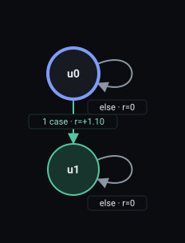
<details><summary>RM text</summary>
<pre>REWARD_MACHINE:
STATES: u0, u1
INITIAL_STATE: u0
FINAL_STATES: u1
DEFAULT_REWARD: 0
TRANSITION_FUNCTION:
(u0, has_key) -&gt; u1
REWARD_FUNCTION:
(u0, has_key, u1) -&gt; 1.1</pre>
</details>
</td>
<td valign="top">
<b>Soft, recurrent off and on (the same machine)</b><br>
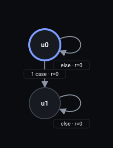
<details><summary>RM text</summary>
<pre>REWARD_MACHINE:
STATES: u0, u1
INITIAL_STATE: u0
FINAL_STATES:
DEFAULT_REWARD: 0
TRANSITION_FUNCTION:
(u0, has_key) -&gt; u1
REWARD_FUNCTION:
(u0, has_key, u1) -&gt; 0.1</pre>
</details>
</td>
</tr></table>

**Hard.** A goal. The first step with `x` reaches the final and ends the episode: in the table,
`- - x` ends at step 3 and `x x` ends at step 1.

**Existence, trace `- - x`**

| Step | Labels | Hard | Soft, recurrent off | Soft, recurrent on (default) |
|---|---|---|---|---|
| 1 | `-` | u0, 0 | u0, 0 | u0, 0 |
| 2 | `-` | u0, 0 | u0, 0 | u0, 0 |
| 3 | `x` | u1 (final), 1.1 | u1, 0.1 | u1, 0.1 |
| **Total** | | 1.1 | 0.1 (0 charges) | 0.1 (0 charges) |

**Soft.** Alone, the machine has no final, so the only reward is progress: +0.1 on the `x` that
moves the rule from waiting to done (summary below). Next to the hard goal `Existence(at_goal)`, the rule shows at
the finish: the soft run ends when the goal is reached, and pays 0.5 less if `x` has not happened
by then. The hard run cannot finish before `x`.

**Existence, all traces**

| Trace | Hard | Soft, recurrent off | Soft, recurrent on (default) |
|---|---|---|---|
| `- - x` | 1.1, ends at step 3 (final) | 0.1 (0 charges) | 0.1 (0 charges) |
| `x x` | 1.1, ends at step 1 (final) | 0.1 (0 charges) | 0.1 (0 charges) |
| `- -` | 0, no end | 0 (0 charges) | 0 (0 charges) |

**Existence next to the goal `Existence(at_goal)`**

| Trace | Rule when `g` arrives | Hard | Soft (recurrent off and on alike) |
|---|---|---|---|
| `x g` | kept | 1.2, ends at step 2 (final) | 1.2, ends at step 2 (final) |
| `g` | open | 0.1, no end | 0.7, ends at step 1 (final) |
| `g x` | open, met after `g` (machine only) | 1.2, ends at step 2 (final) | 0.7, ends at step 1 (final) |

**Existence next to the goal, trace `x g` (the rule is kept when `g` arrives)**

| Step | Labels | Hard | Soft (recurrent off and on alike) |
|---|---|---|---|
| 1 | `x` | u1, 0.1 | u1, 0.1 |
| 2 | `g` | u3 (final), 1.1 | u2 (final), 1.1 |
| **Total** | | 1.2 | 1.2 |

**Existence next to the goal, trace `g` (the rule is open when `g` arrives)**

| Step | Labels | Hard | Soft (recurrent off and on alike) |
|---|---|---|---|
| 1 | `g` | u2, 0.1 | u2 (final), 0.7 |
| **Total** | | 0.1 | 0.7 |

In `x g` the rule is kept and the soft and hard runs finish together. In `g` the soft run finishes
at step 1, 0.5 below the kept finish of `x g`; the hard run has no end. In `g x` (summary above;
machine only, since DoorKey ends at `g`) the hard run finishes at step 2, once `x` arrives, while
the soft run has finished at step 1 with the rule open.

**Recurrent soft.** No difference. Existence never breaks in the middle of an episode: it is "not
yet" until `x` happens and "done" for good afterwards, so there is no break to charge again.
Re-paying it would teach the agent to do `x`, undo it, and do it again instead of finishing: reward
farming. From a goal the agent should reach it, not repeat it.

**What it does not mean.**

- *"Pay every time `x` happens."* The nearest formula is `GF x`, "`x` again and again". It asks for
  infinitely many `x`, so it needs infinite traces, and it pays nothing per `x`. Paying each `x` is a
  reward construction and not a formula: the Reward Machine goes back to its start while the
  environment keeps running. Not done here; the recurrent note describes it under
  [Not tried](../recurrent-soft-rules/README.md#not-tried-reset-the-reward-machine-keep-the-environment).
- *"`x` at a given count or at separate moments"* are other formulas; see ExistenceTwo.

## 2 ExistenceTwo

**Meaning.** `x` is true at two different steps. IBM's formula is `F(door_open & X F door_open)`.
It counts steps, not separate events: `door_open` is a condition, so a door that stays open gives
`x x`. In DoorKey: the door is open at two different steps. Counting up to two needs only three
distinguishable situations (none, one, two or more), which a finite machine holds.

**Machine.** `u0` is the start; `u1` is reached by `x` (one step seen); `u2` is reached by `x x`
(two seen, the hard final).

<table><tr>
<td valign="top">
<b>Hard</b><br>
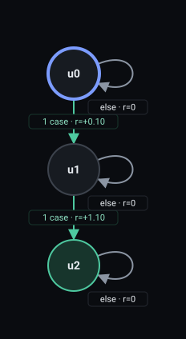
<details><summary>RM text</summary>
<pre>REWARD_MACHINE:
STATES: u0, u1, u2
INITIAL_STATE: u0
FINAL_STATES: u2
DEFAULT_REWARD: 0
TRANSITION_FUNCTION:
(u0, door_open) -&gt; u1
(u1, door_open) -&gt; u2
REWARD_FUNCTION:
(u0, door_open, u1) -&gt; 0.1
(u1, door_open, u2) -&gt; 1.1</pre>
</details>
</td>
<td valign="top">
<b>Soft, recurrent off and on (the same machine)</b><br>
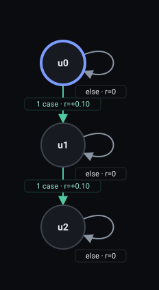
<details><summary>RM text</summary>
<pre>REWARD_MACHINE:
STATES: u0, u1, u2
INITIAL_STATE: u0
FINAL_STATES:
DEFAULT_REWARD: 0
TRANSITION_FUNCTION:
(u0, door_open) -&gt; u1
(u1, door_open) -&gt; u2
REWARD_FUNCTION:
(u0, door_open, u1) -&gt; 0.1
(u1, door_open, u2) -&gt; 0.1</pre>
</details>
</td>
</tr></table>

**Hard.** A goal. The second step with `x` reaches the final, whatever lies between the two: the
trace `x - x` ends at step 3, and `x x` at step 2. The first `x` pays only the progress step.

**ExistenceTwo, trace `x - x`**

| Step | Labels | Hard | Soft, recurrent off | Soft, recurrent on (default) |
|---|---|---|---|---|
| 1 | `x` | u1, 0.1 | u1, 0.1 | u1, 0.1 |
| 2 | `-` | u1, 0 | u1, 0 | u1, 0 |
| 3 | `x` | u2 (final), 1.1 | u2, 0.1 | u2, 0.1 |
| **Total** | | 1.2 | 0.2 (0 charges) | 0.2 (0 charges) |

**Soft.** Alone, +0.1 on each of the two steps of `x` (summary). Next to the goal, finishing with fewer than two steps of `x`
leaves the rule open and costs 0.5 on the finishing edge.

**ExistenceTwo, all traces**

| Trace | Hard | Soft, recurrent off | Soft, recurrent on (default) |
|---|---|---|---|
| `x` | 0.1, no end | 0.1 (0 charges) | 0.1 (0 charges) |
| `x - x` | 1.2, ends at step 3 (final) | 0.2 (0 charges) | 0.2 (0 charges) |
| `x x` | 1.2, ends at step 2 (final) | 0.2 (0 charges) | 0.2 (0 charges) |
| `- - -` | 0, no end | 0 (0 charges) | 0 (0 charges) |

**ExistenceTwo next to the goal `Existence(at_goal)`**

| Trace | Rule when `g` arrives | Hard | Soft (recurrent off and on alike) |
|---|---|---|---|
| `x x g` | kept | 1.3, ends at step 3 (final) | 1.3, ends at step 3 (final) |
| `x g` | open | 0.2, no end | 0.8, ends at step 2 (final) |
| `g` | open | 0.1, no end | 0.8, ends at step 1 (final) |
| `x g x` | open, met after `g` (machine only) | 1.3, ends at step 3 (final) | 0.8, ends at step 2 (final) |

**ExistenceTwo next to the goal, trace `x x g` (the rule is kept when `g` arrives)**

| Step | Labels | Hard | Soft (recurrent off and on alike) |
|---|---|---|---|
| 1 | `x` | u1, 0.1 | u1, 0.1 |
| 2 | `x` | u4, 0.1 | u3, 0.1 |
| 3 | `g` | u5 (final), 1.1 | u2 (final), 1.1 |
| **Total** | | 1.3 | 1.3 |

**ExistenceTwo next to the goal, trace `x g` (the rule is open when `g` arrives)**

| Step | Labels | Hard | Soft (recurrent off and on alike) |
|---|---|---|---|
| 1 | `x` | u1, 0.1 | u1, 0.1 |
| 2 | `g` | u3, 0.1 | u2 (final), 0.7 |
| **Total** | | 0.2 | 0.8 |

With both steps of `x` before the goal (`x x g`), soft and hard finish with the same total. With one
(`x g`) or none (`g`), the soft run finishes at the goal step with 0.5 less, and the hard run
waits.

**Recurrent soft.** No difference, for the same reason as Existence: it never breaks in the middle
of an episode.

**What it does not mean.**

- *"Pay every time `x` happens"*: a reward construction and not a formula, as under Existence. Not
  done.
- *"`x` three times."* This is valid LTLf, `F(x & X F(x & X F x))`, but not one of the eight
  templates. It compiles to a four-state DFA instead of three, and its final comes at the third
  step with `x`:

**Variant ExistenceThree next to the template, hard result and charges recurrent on / off**

| Trace | ExistenceTwo | Variant ExistenceThree |
|---|---|---|
| `x x` | 1.2, ends at step 2 (final); charges 0 / 0 | 0.2, no end; charges 0 / 0 |
| `x x x` | 1.2, ends at step 2 (final); charges 0 / 0 | 1.3, ends at step 3 (final); charges 0 / 0 |

- *"The door is opened twice, with a closed door in between."* Here `x` is a state condition, and
  the template counts steps where it is true. "`x`, then not `x`, then `x` again" is another formula,
  `F(x & X F(!x & X F x))`:

**Variant TwoSeparate next to the template, hard result and charges recurrent on / off**

| Trace | ExistenceTwo | Variant TwoSeparate |
|---|---|---|
| `x x` | 1.2, ends at step 2 (final); charges 0 / 0 | 0.1, no end; charges 0 / 0 |
| `x - x` | 1.2, ends at step 3 (final); charges 0 / 0 | 1.3, ends at step 3 (final); charges 0 / 0 |

## 3 Absence

**Meaning.** `x` never happens. IBM's formula is `~(F key_lost)`. It looks at the whole episode. In
DoorKey: the key is never lost. `key_lost` is an event, so each loss is one step with `x`; picking
the key up again and losing it a second time gives `x` twice, with other steps between.

**Machine.** `u0` is the start; `u1` is reached by `x` and is the broken state. The MONA DFA has a
broken-for-good state, so the hard version sends `u1` to the well and the soft machine can re-arm.

<table><tr>
<td valign="top">
<b>Hard</b><br>
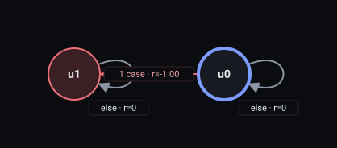
<details><summary>RM text</summary>
<pre>REWARD_MACHINE:
STATES: u0, u1
INITIAL_STATE: u0
FINAL_STATES:
REJECTING_STATES: u1
DEFAULT_REWARD: 0
TRANSITION_FUNCTION:
(u0, key_lost) -&gt; u1
REWARD_FUNCTION:
(u0, key_lost, u1) -&gt; -1</pre>
</details>
</td>
<td valign="top">
<b>Soft, recurrent off</b><br>
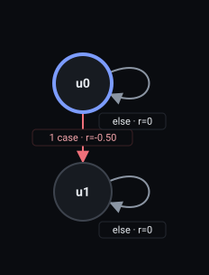
<details><summary>RM text</summary>
<pre>REWARD_MACHINE:
STATES: u0, u1
INITIAL_STATE: u0
FINAL_STATES:
DEFAULT_REWARD: 0
TRANSITION_FUNCTION:
(u0, key_lost) -&gt; u1
REWARD_FUNCTION:
(u0, key_lost, u1) -&gt; -0.5</pre>
</details>
</td>
<td valign="top">
<b>Soft, recurrent on (default)</b><br>
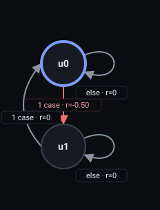
<details><summary>RM text</summary>
<pre>REWARD_MACHINE:
STATES: u0, u1
INITIAL_STATE: u0
FINAL_STATES:
DEFAULT_REWARD: 0
TRANSITION_FUNCTION:
(u0, key_lost) -&gt; u1
(u1, !key_lost) -&gt; u0
REWARD_FUNCTION:
(u0, key_lost, u1) -&gt; -0.5</pre>
</details>
</td>
</tr></table>

**Hard.** The first `x` sends the run to the well, −1, and the episode ends at that step.

**Soft, recurrent off.** The first `x` costs −0.5. The broken state is a trap: it stays broken for
the rest of the episode, and every later `x` is free. Every trace of the table that contains an `x`
charges once.

**Soft, recurrent on.** The broken state takes the start state's edges. The step after a charge is
read as a fresh start, so a step without `x` re-arms the rule, and the next `x` charges again.
An `x` straight after a charged `x` is a break while still broken, and it is free.

**Absence, the step after a charge**

| Next step | Soft, recurrent off | Soft, recurrent on (default) |
|---|---|---|
| `-` | u1, 0 | u0, 0 |
| `x` | u1, 0 | u1, 0 |

**Absence, all traces**

| Trace | Hard | Soft, recurrent off | Soft, recurrent on (default) |
|---|---|---|---|
| `x x` | −1, ends at step 1 (well) | −0.5 (1 charge) | −0.5 (1 charge) |
| `x - x` | −1, ends at step 1 (well) | −0.5 (1 charge) | −1 (2 charges) |
| `x x x` | −1, ends at step 1 (well) | −0.5 (1 charge) | −0.5 (1 charge) |
| `x - x x` | −1, ends at step 1 (well) | −0.5 (1 charge) | −1 (2 charges) |
| `- -` | 0, no end | 0 (0 charges) | 0 (0 charges) |
| `x - x - x` | −1, ends at step 1 (well) | −0.5 (1 charge) | −1.5 (3 charges) |

**Absence, trace `x x`**

| Step | Labels | Hard | Soft, recurrent off | Soft, recurrent on (default) |
|---|---|---|---|---|
| 1 | `x` | u1 (well), −1 | u1, −0.5 | u1, −0.5 |
| 2 | `x` | — | u1, 0 | u1, 0 |
| **Total** | | −1 | −0.5 (1 charge) | −0.5 (1 charge) |

**Absence, trace `x - x`**

| Step | Labels | Hard | Soft, recurrent off | Soft, recurrent on (default) |
|---|---|---|---|---|
| 1 | `x` | u1 (well), −1 | u1, −0.5 | u1, −0.5 |
| 2 | `-` | — | u1, 0 | u0, 0 |
| 3 | `x` | — | u1, 0 | u1, −0.5 |
| **Total** | | −1 | −0.5 (1 charge) | −1 (2 charges) |

**Absence, trace `x - x x`**

| Step | Labels | Hard | Soft, recurrent off | Soft, recurrent on (default) |
|---|---|---|---|---|
| 1 | `x` | u1 (well), −1 | u1, −0.5 | u1, −0.5 |
| 2 | `-` | — | u1, 0 | u0, 0 |
| 3 | `x` | — | u1, 0 | u1, −0.5 |
| 4 | `x` | — | u1, 0 | u1, 0 |
| **Total** | | −1 | −0.5 (1 charge) | −1 (2 charges) |

Read the rows as follows. `x x` and `x x x` charge once: the second step breaks a rule that is
already broken. `x - x` and `x - x x` charge twice: the `-` re-arms the rule, the next `x` is a new
break, and a further `x` right after it is free. `x - x - x` charges three times with the switch on
and once with it off.

A condition that stays true, such as an open door under `Absence(door_open)`, is therefore one break
and not one break per step. This is our choice and not a property of the formula: the formula only
says that `x` never happens, and a break is counted as the step where the rule goes from kept to
broken.

**What it does not mean.**

- *"Charge every step in which `x` is true."* That is not what happens: a break straight after a
  break is free. Charging each step would price a different thing, the time spent in violation,
  while the machine prices the number of breaks.
- *"Forgive the first break."* The formula `~(F x)` has no such clause. The first `x` always breaks
  the rule.

## 4 RespondedExistence

**Meaning.** If `x` happens, `y` happens at some step too, before, with or after it. IBM's formula
is `(F door_open) -> (F has_key)`. It looks at the whole episode, in any order. In DoorKey: if the
door ever opens, the agent also holds the key at some step.

**Machine.** `u0` is the start; `u2` is reached by `x` and means "`x` seen, `y` owed"; `u1` is
reached by `y` (or by `xy`) and means "`y` seen", done for good. The DFA has no broken-for-good
state: an owed `y` can always still arrive. The three versions are the same machine.

<table><tr>
<td valign="top">
<b>Hard, soft off and soft on (the same machine alone)</b><br>
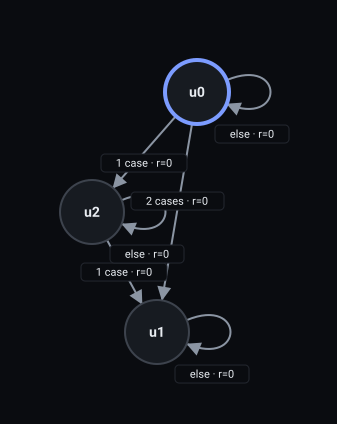
<details><summary>RM text</summary>
<pre>REWARD_MACHINE:
STATES: u0, u1, u2
INITIAL_STATE: u0
FINAL_STATES:
DEFAULT_REWARD: 0
TRANSITION_FUNCTION:
(u0, !door_open&amp;has_key) -&gt; u1
(u0, door_open&amp;!has_key) -&gt; u2
(u0, door_open&amp;has_key) -&gt; u1
(u2, has_key) -&gt; u1
REWARD_FUNCTION:
(u0, door_open&amp;!has_key, u2) -&gt; -0.1
(u2, has_key, u1) -&gt; 0.1</pre>
</details>
</td>
</tr></table>

**Hard and soft, alone.** The machine has no final, so a missing `y` blocks nothing, and the rule
never reaches the well. Progress aims at the states where no `y` is owed: the `x` that leaves a `y`
owed costs 0.1 and the `y` pays it back (`x y` totals 0), so an `x` left unanswered when the trace
ends totals −0.1 (`x -` in the summary). Hard and soft are the same machine.

**RespondedExistence, all traces**

| Trace | Hard | Soft, recurrent off | Soft, recurrent on (default) |
|---|---|---|---|
| `y x` | 0, no end | 0 (0 charges) | 0 (0 charges) |
| `x y` | 0, no end | 0 (0 charges) | 0 (0 charges) |
| `x x y` | 0, no end | 0 (0 charges) | 0 (0 charges) |
| `x -` | −0.1, no end | −0.1 (0 charges) | −0.1 (0 charges) |
| `- -` | 0, no end | 0 (0 charges) | 0 (0 charges) |

**RespondedExistence, trace `x x y`**

| Step | Labels | Hard | Soft, recurrent off | Soft, recurrent on (default) |
|---|---|---|---|---|
| 1 | `x` | u2, −0.1 | u2, −0.1 | u2, −0.1 |
| 2 | `x` | u2, 0 | u2, 0 | u2, 0 |
| 3 | `y` | u1, 0.1 | u1, 0.1 | u1, 0.1 |
| **Total** | | 0 | 0 (0 charges) | 0 (0 charges) |

**Next to a goal.** The effect shows at the finish. In the hard run an owed `y` blocks the final:
`x g` has no end, and `x g y` (machine only, since DoorKey ends at `g`) finishes at step 3 once `y`
has arrived. In the soft run the goal ends the episode, and an owed `y` costs 0.5. The order of `x`
and `y` does not matter: `x y g` and `y x g` both keep the rule.

**RespondedExistence next to the goal `Existence(at_goal)`**

| Trace | Rule when `g` arrives | Hard | Soft (recurrent off and on alike) |
|---|---|---|---|
| `g` | kept | 1.3, ends at step 1 (final) | 1.3, ends at step 1 (final) |
| `x y g` | kept | 1.3, ends at step 3 (final) | 1.3, ends at step 3 (final) |
| `y x g` | kept | 1.3, ends at step 3 (final) | 1.3, ends at step 3 (final) |
| `x g` | open | 0.2, no end | 0.8, ends at step 2 (final) |
| `x g y` | open, met after `g` (machine only) | 1.3, ends at step 3 (final) | 0.8, ends at step 2 (final) |

**RespondedExistence next to the goal, trace `y x g` (the rule is kept when `g` arrives)**

| Step | Labels | Hard | Soft (recurrent off and on alike) |
|---|---|---|---|
| 1 | `y` | u1, 0.2 | u1, 0.2 |
| 2 | `x` | u1, 0 | u1, 0 |
| 3 | `g` | u3 (final), 1.1 | u3 (final), 1.1 |
| **Total** | | 1.3 | 1.3 |

**RespondedExistence next to the goal, trace `x g` (the rule is open when `g` arrives)**

| Step | Labels | Hard | Soft (recurrent off and on alike) |
|---|---|---|---|
| 1 | `x` | u2, 0.1 | u2, 0.1 |
| 2 | `g` | u4, 0.1 | u3 (final), 0.7 |
| **Total** | | 0.2 | 0.8 |

**Recurrent soft.** No difference, and no exact recurring version exists. The rule means "if `x`,
then `y` at some point, in any order". Two rules come close, and each fixes an order, so each is
stricter than RespondedExistence:

- *The `y`-before version* is Precedence(`y`, `x`). It can break in the middle of an episode, so with
  the switch on it charges each new `x` before the first `y`; an `x` straight after a charged one is
  free. It is the closest recurring version of RespondedExistence.
- *The `y`-after version* is Response(`x`, `y`). Each new `x` opens an obligation, but the rule never
  breaks in the middle of an episode, so nothing is charged before the end.

Each version keeps only one of the two orders. The `y`-before version is broken by an `x` before the
first `y`. The `y`-after version is not met by a `y` before the `x`, which leaves an `x` that owes a
`y`; alone it never charges, since an unmet obligation only costs something at the finish. The table
walks one set of traces through RespondedExistence and through the two versions, written in
RespondedExistence's own letters (`x` = `door_open`, `y` = `has_key`).

**RespondedExistence and its two ordered rules, charges recurrent on / off**

| Trace | RespondedExistence | `y`-before version | `y`-after version |
|---|---|---|---|
| `y x` | 0 / 0 | 0 / 0 | 0 / 0 |
| `x y` | 0 / 0 | 1 / 1 | 0 / 0 |
| `x y x` | 0 / 0 | 1 / 1 | 0 / 0 |
| `y x x` | 0 / 0 | 0 / 0 | 0 / 0 |
| `x x y` | 0 / 0 | 1 / 1 | 0 / 0 |
| `x - x y` | 0 / 0 | 2 / 1 | 0 / 0 |
| `x x` | 0 / 0 | 1 / 1 | 0 / 0 |
| `x -` | 0 / 0 | 1 / 1 | 0 / 0 |

`x y` is the clearest row: RespondedExistence accepts it, and the `y`-before version charges it,
because it asks `y` first. `x y x` shows that the two versions are not a split of
RespondedExistence. It holds there, since a `y` exists. The `y`-before version breaks at the first
`x`, and the `y`-after version leaves the last `x` without a `y` after it (no charge alone, as said
above). So neither "both hold" nor "one holds" gives RespondedExistence back. Keeping the "any
order" meaning with a `y` for each `x` would need at least as many `y` as `x`, a count no finite
automaton keeps (see the
[limitation](../recurrent-soft-rules/README.md#limitation-the-setup-cannot-count) of the recurrent
note).

**What it does not mean.**

- *"Each `x` needs its own `y`."* That needs counting. In the table above, `x x y` leaves
  RespondedExistence at 0 charges: one `y` covers every `x`.
- *"`y` within a number of steps of `x`."* Not in the set; the Response section shows the formula and
  the contrast.

## 5 Response

**Meaning.** Every `x` is followed by `y` on the same step or later. IBM's formula is
`G(has_key -> F door_open)`. Response looks to the future: if `x` happens, `y` must happen at some
later step, and the same step counts. In DoorKey: every time the agent holds the key, the door is
open on that step or later.

**Machine.** `u0` is the start, with no open obligation; `u1` is reached by `x` and means "`x` seen,
`y` owed". A `y` returns to `u0`. The DFA has no broken-for-good state: an unanswered `x` is never
lost, since a later `y` still answers it. The three versions are the same machine.

<table><tr>
<td valign="top">
<b>Hard, soft off and soft on (the same machine alone)</b><br>
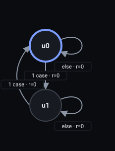
<details><summary>RM text</summary>
<pre>REWARD_MACHINE:
STATES: u0, u1
INITIAL_STATE: u0
FINAL_STATES:
DEFAULT_REWARD: 0
TRANSITION_FUNCTION:
(u0, !door_open&amp;has_key) -&gt; u1
(u1, door_open) -&gt; u0
REWARD_FUNCTION:
(u0, !door_open&amp;has_key, u1) -&gt; -0.1
(u1, door_open, u0) -&gt; 0.1</pre>
</details>
</td>
</tr></table>

**Hard and soft, alone.** As for RespondedExistence: no final to block, and no well. The `x` that
opens an obligation costs 0.1 and the `y` that answers it pays it back; an `x` still unanswered when
the trace ends totals −0.1. Hard and soft are the same machine.

**Response, all traces**

| Trace | Hard | Soft, recurrent off | Soft, recurrent on (default) |
|---|---|---|---|
| `x y` | 0, no end | 0 (0 charges) | 0 (0 charges) |
| `x x y` | 0, no end | 0 (0 charges) | 0 (0 charges) |
| `x - y` | 0, no end | 0 (0 charges) | 0 (0 charges) |
| `x x` | −0.1, no end | −0.1 (0 charges) | −0.1 (0 charges) |
| `x y x` | −0.1, no end | −0.1 (0 charges) | −0.1 (0 charges) |
| `y` | 0, no end | 0 (0 charges) | 0 (0 charges) |
| `- -` | 0, no end | 0 (0 charges) | 0 (0 charges) |
| `xy` | 0, no end | 0 (0 charges) | 0 (0 charges) |

**Response, trace `x x y`**

| Step | Labels | Hard | Soft, recurrent off | Soft, recurrent on (default) |
|---|---|---|---|---|
| 1 | `x` | u1, −0.1 | u1, −0.1 | u1, −0.1 |
| 2 | `x` | u1, 0 | u1, 0 | u1, 0 |
| 3 | `y` | u0, 0.1 | u0, 0.1 | u0, 0.1 |
| **Total** | | 0 | 0 (0 charges) | 0 (0 charges) |

`x x y` keeps the rule: one `y` answers every earlier `x`. A `y` on the same step as `x` also
answers it, so no obligation is opened:

**Response, trace `xy`**

| Step | Labels | Hard | Soft, recurrent off | Soft, recurrent on (default) |
|---|---|---|---|---|
| 1 | `xy` | u0, 0 | u0, 0 | u0, 0 |
| **Total** | | 0 | 0 (0 charges) | 0 (0 charges) |

**Next to a goal.** An unanswered `x` blocks the hard final and costs 0.5 on the soft finishing edge.
With the obligation met, soft finishes at 1.1; with it open, 0.6. Hard pays 1.2 where soft pays 1.1:
the hard machine has one more state on the way to the final, the goal reached with an `x`
unanswered, which is no final, so its progress differs
([hard](check/graphs/Response.goal.hard.rm) and [soft](check/graphs/Response.goal.soft.rm) machines).

**Response next to the goal `Existence(at_goal)`**

| Trace | Rule when `g` arrives | Hard | Soft (recurrent off and on alike) |
|---|---|---|---|
| `g` | kept | 1.2, ends at step 1 (final) | 1.1, ends at step 1 (final) |
| `x y g` | kept | 1.2, ends at step 3 (final) | 1.1, ends at step 3 (final) |
| `x x y g` | kept | 1.2, ends at step 4 (final) | 1.1, ends at step 4 (final) |
| `x g` | open | 0.1, no end | 0.6, ends at step 2 (final) |
| `x g y` | open, met after `g` (machine only) | 1.2, ends at step 3 (final) | 0.6, ends at step 2 (final) |

**Response next to the goal, trace `x x y g` (the rule is kept when `g` arrives)**

| Step | Labels | Hard | Soft (recurrent off and on alike) |
|---|---|---|---|
| 1 | `x` | u1, 0 | u1, 0 |
| 2 | `x` | u1, 0 | u1, 0 |
| 3 | `y` | u0, 0 | u0, 0 |
| 4 | `g` | u2 (final), 1.2 | u2 (final), 1.1 |
| **Total** | | 1.2 | 1.1 |

**Response next to the goal, trace `x g` (the rule is open when `g` arrives)**

| Step | Labels | Hard | Soft (recurrent off and on alike) |
|---|---|---|---|
| 1 | `x` | u1, 0 | u1, 0 |
| 2 | `g` | u3, 0.1 | u2 (final), 0.6 |
| **Total** | | 0.1 | 0.6 |

**Recurrent soft.** No difference: there is no broken state to re-arm. Response needs no re-arm,
since after a `y` the machine is back in `u0`, and the next `x` opens a new obligation.

**What it does not mean.**

- *"Each `x` needs its own `y`."* This needs counting, which a finite machine cannot do for an
  unbounded number of `x`. `x x y` keeps the rule.
- *"`y` within `k` steps of `x`."* This is a valid formula and not a template. For `k` = 1 it is
  `G(x -> (y | X y))`. It has a broken-for-good state, so `x - y` is a break there and not in
  Response:

**Variant WithinOneStep next to the template, hard result and charges recurrent on / off**

| Trace | Response | Variant WithinOneStep |
|---|---|---|
| `x y` | 0, no end; charges 0 / 0 | 0, no end; charges 0 / 0 |
| `x - y` | 0, no end; charges 0 / 0 | −1.1, ends at step 2 (well); charges 1 / 1 |
| `x - -` | −0.1, no end; charges 0 / 0 | −1.1, ends at step 2 (well); charges 1 / 1 |

## 6 Precedence

**Meaning.** `y` does not happen before `x` has happened. IBM's formula for
Precedence(has_key, door_open) is `((~door_open) U has_key) | (G (~door_open))`: the door stays
closed until the key is held, or stays closed forever. Precedence looks to the past: for `y` to
happen, `x` must have happened before. The same step counts as before (`xy` is not a break,
see the summary). In DoorKey: the door does not open before the key has been held.

**Machine.** `u0` is the start; `u1` is reached by `x` and means "`x` seen" ("key had"), done for
good; `u2` is reached by `y` and is the broken state (`y` came before any `x`).

<table><tr>
<td valign="top">
<b>Hard</b><br>
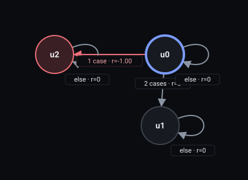
<details><summary>RM text</summary>
<pre>REWARD_MACHINE:
STATES: u0, u1, u2
INITIAL_STATE: u0
FINAL_STATES:
REJECTING_STATES: u2
DEFAULT_REWARD: 0
TRANSITION_FUNCTION:
(u0, !door_open&amp;has_key) -&gt; u1
(u0, door_open&amp;!has_key) -&gt; u2
(u0, door_open&amp;has_key) -&gt; u1
REWARD_FUNCTION:
(u0, door_open&amp;!has_key, u2) -&gt; -1</pre>
</details>
</td>
<td valign="top">
<b>Soft, recurrent off</b><br>
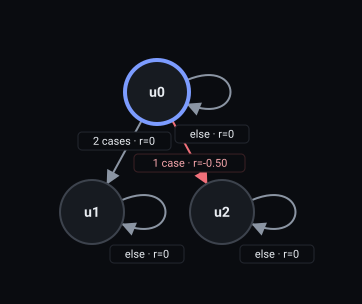
<details><summary>RM text</summary>
<pre>REWARD_MACHINE:
STATES: u0, u1, u2
INITIAL_STATE: u0
FINAL_STATES:
DEFAULT_REWARD: 0
TRANSITION_FUNCTION:
(u0, !door_open&amp;has_key) -&gt; u1
(u0, door_open&amp;!has_key) -&gt; u2
(u0, door_open&amp;has_key) -&gt; u1
REWARD_FUNCTION:
(u0, door_open&amp;!has_key, u2) -&gt; -0.5</pre>
</details>
</td>
<td valign="top">
<b>Soft, recurrent on (default)</b><br>
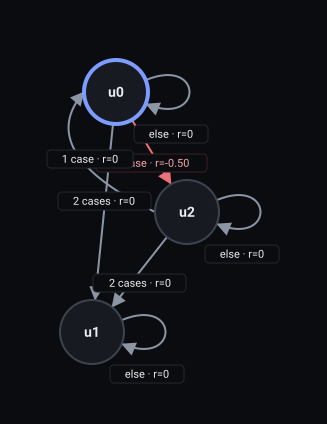
<details><summary>RM text</summary>
<pre>REWARD_MACHINE:
STATES: u0, u1, u2
INITIAL_STATE: u0
FINAL_STATES:
DEFAULT_REWARD: 0
TRANSITION_FUNCTION:
(u0, !door_open&amp;has_key) -&gt; u1
(u0, door_open&amp;!has_key) -&gt; u2
(u0, door_open&amp;has_key) -&gt; u1
(u2, !door_open&amp;!has_key) -&gt; u0
(u2, !door_open&amp;has_key) -&gt; u1
(u2, door_open&amp;has_key) -&gt; u1
REWARD_FUNCTION:
(u0, door_open&amp;!has_key, u2) -&gt; -0.5</pre>
</details>
</td>
</tr></table>

**Hard.** A `y` before any `x` sends the run to the well, −1, and the episode ends: `y y`, `y x y` and
`y - y x` all end at step 1.

**Soft, recurrent off.** The first break costs −0.5, once; `u2` is then a trap.

**Soft, recurrent on.** The broken state `u2` takes the start state's edges. Before the first `x`,
each new `y` is a break: opening the door without ever having had the key charges, and so does each
later opening, as long as the key has not been taken. A step with neither (`-`) re-arms the rule, and
a step with `x` ends the charging for good. A door that stays open is one break, since `y` is a
condition and a break straight after a break is free.

**Precedence, the step after a charge**

| Next step | Soft, recurrent off | Soft, recurrent on (default) |
|---|---|---|
| `-` | u2, 0 | u0, 0 |
| `x` | u2, 0 | u1, 0 |
| `y` | u2, 0 | u2, 0 |
| `xy` | u2, 0 | u1, 0 |

**Precedence, all traces**

| Trace | Hard | Soft, recurrent off | Soft, recurrent on (default) |
|---|---|---|---|
| `x y y` | 0, no end | 0 (0 charges) | 0 (0 charges) |
| `y - y x` | −1, ends at step 1 (well) | −0.5 (1 charge) | −1 (2 charges) |
| `y y` | −1, ends at step 1 (well) | −0.5 (1 charge) | −0.5 (1 charge) |
| `y x y` | −1, ends at step 1 (well) | −0.5 (1 charge) | −0.5 (1 charge) |
| `- y - y` | −1, ends at step 2 (well) | −0.5 (1 charge) | −1 (2 charges) |
| `- -` | 0, no end | 0 (0 charges) | 0 (0 charges) |
| `x - y` | 0, no end | 0 (0 charges) | 0 (0 charges) |
| `x y - y` | 0, no end | 0 (0 charges) | 0 (0 charges) |
| `xy` | 0, no end | 0 (0 charges) | 0 (0 charges) |
| `y - y x - y` | −1, ends at step 1 (well) | −0.5 (1 charge) | −1 (2 charges) |
| `y x - y` | −1, ends at step 1 (well) | −0.5 (1 charge) | −0.5 (1 charge) |
| `y y - y` | −1, ends at step 1 (well) | −0.5 (1 charge) | −1 (2 charges) |

**Precedence, trace `x y y`**

| Step | Labels | Hard | Soft, recurrent off | Soft, recurrent on (default) |
|---|---|---|---|---|
| 1 | `x` | u1, 0 | u1, 0 | u1, 0 |
| 2 | `y` | u1, 0 | u1, 0 | u1, 0 |
| 3 | `y` | u1, 0 | u1, 0 | u1, 0 |
| **Total** | | 0 | 0 (0 charges) | 0 (0 charges) |

**Precedence, trace `y - y x`**

| Step | Labels | Hard | Soft, recurrent off | Soft, recurrent on (default) |
|---|---|---|---|---|
| 1 | `y` | u2 (well), −1 | u2, −0.5 | u2, −0.5 |
| 2 | `-` | — | u2, 0 | u0, 0 |
| 3 | `y` | — | u2, 0 | u2, −0.5 |
| 4 | `x` | — | u2, 0 | u1, 0 |
| **Total** | | −1 | −0.5 (1 charge) | −1 (2 charges) |

**Precedence, trace `y y`**

| Step | Labels | Hard | Soft, recurrent off | Soft, recurrent on (default) |
|---|---|---|---|---|
| 1 | `y` | u2 (well), −1 | u2, −0.5 | u2, −0.5 |
| 2 | `y` | — | u2, 0 | u2, 0 |
| **Total** | | −1 | −0.5 (1 charge) | −0.5 (1 charge) |

**Precedence, trace `- y - y`**

| Step | Labels | Hard | Soft, recurrent off | Soft, recurrent on (default) |
|---|---|---|---|---|
| 1 | `-` | u0, 0 | u0, 0 | u0, 0 |
| 2 | `y` | u2 (well), −1 | u2, −0.5 | u2, −0.5 |
| 3 | `-` | — | u2, 0 | u0, 0 |
| 4 | `y` | — | u2, 0 | u2, −0.5 |
| **Total** | | −1 | −0.5 (1 charge) | −1 (2 charges) |

**Once `x` has happened, the rule is done for good.** From `u1` nothing breaks the rule any more:
closing the door, dropping or losing the key, and opening again are all free. `x - y` and
`x y - y` charge 0. This holds also after a break: a later `x` ends the charging for good, as in
`y x y` (one charge, the last `y` is free) and in `y - y x - y` (two charges, the opening after `x` is free).

**Precedence, trace `x - y`**

| Step | Labels | Hard | Soft, recurrent off | Soft, recurrent on (default) |
|---|---|---|---|---|
| 1 | `x` | u1, 0 | u1, 0 | u1, 0 |
| 2 | `-` | u1, 0 | u1, 0 | u1, 0 |
| 3 | `y` | u1, 0 | u1, 0 | u1, 0 |
| **Total** | | 0 | 0 (0 charges) | 0 (0 charges) |

**Precedence, trace `y x y`**

| Step | Labels | Hard | Soft, recurrent off | Soft, recurrent on (default) |
|---|---|---|---|---|
| 1 | `y` | u2 (well), −1 | u2, −0.5 | u2, −0.5 |
| 2 | `x` | — | u2, 0 | u1, 0 |
| 3 | `y` | — | u2, 0 | u1, 0 |
| **Total** | | −1 | −0.5 (1 charge) | −0.5 (1 charge) |

**Precedence, trace `y - y x - y`**

| Step | Labels | Hard | Soft, recurrent off | Soft, recurrent on (default) |
|---|---|---|---|---|
| 1 | `y` | u2 (well), −1 | u2, −0.5 | u2, −0.5 |
| 2 | `-` | — | u2, 0 | u0, 0 |
| 3 | `y` | — | u2, 0 | u2, −0.5 |
| 4 | `x` | — | u2, 0 | u1, 0 |
| 5 | `-` | — | u2, 0 | u1, 0 |
| 6 | `y` | — | u2, 0 | u1, 0 |
| **Total** | | −1 | −0.5 (1 charge) | −1 (2 charges) |

This is the meaning of the formula, "no `y` before the first `x`", and not a choice made against
reward farming. There is nothing to farm: keeping a rule pays nothing, unlike a goal, and a
satisfied Precedence only stops charging. Once the key has been taken, there is no way to break the
rule again, even if the key is lost afterwards (`x - y` above).

**In DoorKey this rule cannot break.** `door_open` cannot become true before `has_key`, since only
toggling the door with the key in hand unlocks it
([`environment.md:30`](../../../examples/arm-fm/minigrid-doorkey/environment.md)), and nothing
relocks a door once it is unlocked (line 41). The traces show what the machine would do on
valuations the environment never produces.

**What it does not mean.**

- *"The door only opens while the key is held."* The rule asks that `x` happened, not that `x` still
  holds: "had the key", not "holds the key". The other rule is `G(door_open -> has_key)`. It is valid
  LTLf, and MONA builds a machine with a broken-for-good state for it, so recurrent on would charge
  each opening without the key in hand. It is not one of the eight IBM templates, so the generator
  cannot write it today. The compiler never adds edges to a clause's DFA by hand beyond the re-arm:
  the clause DFA is whatever MONA builds from the formula. That rule needs edges the Precedence
  machine does not have: going back when the key is lost, and a break on an opening without the key.
  So it is a different formula and not a recurrent Precedence; the separately compiled HoldingKey
  machine below is the example. Getting it would need a new template (for example Absence over
  `door_open & !has_key`), which is out of scope. In DoorKey this other rule can break (unlock the door, close it, drop the key, open
  the door again: nothing relocks it), while Precedence(has_key, door_open) cannot.

**Variant HoldingKey next to the template, hard result and charges recurrent on / off**

| Trace | Precedence | Variant HoldingKey |
|---|---|---|
| `x xy` | 0, no end; charges 0 / 0 | 0, no end; charges 0 / 0 |
| `x - y` | 0, no end; charges 0 / 0 | −1, ends at step 3 (well); charges 1 / 1 |
| `y` | −1, ends at step 1 (well); charges 1 / 1 | −1, ends at step 1 (well); charges 1 / 1 |
| `y x y` | −1, ends at step 1 (well); charges 1 / 1 | −1, ends at step 1 (well); charges 2 / 1 |
| `y - y` | −1, ends at step 1 (well); charges 2 / 1 | −1, ends at step 1 (well); charges 2 / 1 |

- *"`x` strictly before `y`."* Precedence allows `xy`. A strict version forbids it,
  `(~y U (x & ~y)) | G ~y`. The design note leaves it for a later iteration
  ([Why shorter RM paths get no extra reward](../../COMPILER_REWARD_DESIGN.md#why-shorter-rm-paths-get-no-extra-reward)).

**Variant StrictPrecedence next to the template, hard result and charges recurrent on / off**

| Trace | Precedence | Variant StrictPrecedence |
|---|---|---|
| `x y` | 0, no end; charges 0 / 0 | 0, no end; charges 0 / 0 |
| `xy` | 0, no end; charges 0 / 0 | −1, ends at step 1 (well); charges 1 / 1 |

## 7 ChainResponse

**Meaning.** Every `x` is followed by `y` on the very next step. IBM's formula is
`G(has_key -> X door_open)`. ChainResponse looks to the next step: if `x` happens, `y` must happen
right after. In DoorKey: every time the agent holds the key, the door is open on the next step.

**Machine.** `u0` is the start; `u1` is reached by `x` and means "`x` seen, `y` owed on the next
step"; `u2` is reached by `x -` and is the broken state. The break is seen on the step after `x`,
when that step lacks `y`.

<table><tr>
<td valign="top">
<b>Hard</b><br>
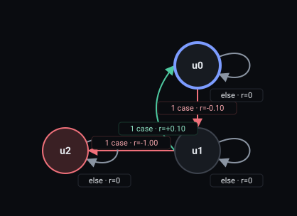
<details><summary>RM text</summary>
<pre>REWARD_MACHINE:
STATES: u0, u1, u2
INITIAL_STATE: u0
FINAL_STATES:
REJECTING_STATES: u2
DEFAULT_REWARD: 0
TRANSITION_FUNCTION:
(u0, has_key) -&gt; u1
(u1, !door_open) -&gt; u2
(u1, door_open&amp;!has_key) -&gt; u0
REWARD_FUNCTION:
(u0, has_key, u1) -&gt; -0.1
(u1, !door_open, u2) -&gt; -1
(u1, door_open&amp;!has_key, u0) -&gt; 0.1</pre>
</details>
</td>
<td valign="top">
<b>Soft, recurrent off</b><br>
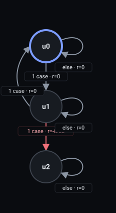
<details><summary>RM text</summary>
<pre>REWARD_MACHINE:
STATES: u0, u1, u2
INITIAL_STATE: u0
FINAL_STATES:
DEFAULT_REWARD: 0
TRANSITION_FUNCTION:
(u0, has_key) -&gt; u1
(u1, !door_open) -&gt; u2
(u1, door_open&amp;!has_key) -&gt; u0
REWARD_FUNCTION:
(u0, has_key, u1) -&gt; -0.1
(u1, !door_open, u2) -&gt; -0.4
(u1, door_open&amp;!has_key, u0) -&gt; 0.1</pre>
</details>
</td>
<td valign="top">
<b>Soft, recurrent on (default)</b><br>
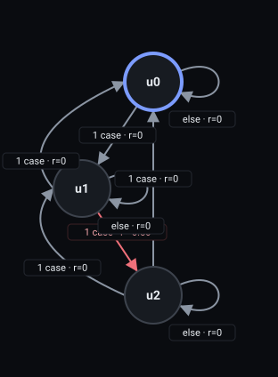
<details><summary>RM text</summary>
<pre>REWARD_MACHINE:
STATES: u0, u1, u2
INITIAL_STATE: u0
FINAL_STATES:
DEFAULT_REWARD: 0
TRANSITION_FUNCTION:
(u0, has_key) -&gt; u1
(u1, !door_open) -&gt; u2
(u1, door_open&amp;!has_key) -&gt; u0
(u2, !has_key) -&gt; u0
(u2, has_key) -&gt; u1
REWARD_FUNCTION:
(u0, has_key, u1) -&gt; -0.1
(u1, !door_open, u2) -&gt; -0.4
(u1, door_open&amp;!has_key, u0) -&gt; 0.1
(u2, has_key, u1) -&gt; -0.1</pre>
</details>
</td>
</tr></table>

**Hard.** A step without `y` right after an `x` sends the run to the well, −1, and the episode ends
at that step.

**Soft, recurrent off.** The first break costs −0.5, once.

**Soft, recurrent on.** The broken state takes the start state's edges, so the rule watches again
from the step after the break.

**ChainResponse, the step after a charge**

| Next step | Soft, recurrent off | Soft, recurrent on (default) |
|---|---|---|
| `-` | u2, 0 | u0, 0 |
| `x` | u2, 0 | u1, −0.1 |
| `y` | u2, 0 | u0, 0 |
| `xy` | u2, 0 | u1, −0.1 |

**ChainResponse, all traces**

| Trace | Hard | Soft, recurrent off | Soft, recurrent on (default) |
|---|---|---|---|
| `x y` | 0, no end | 0 (0 charges) | 0 (0 charges) |
| `x - x -` | −1.1, ends at step 2 (well) | −0.5 (1 charge) | −1 (2 charges) |
| `x x -` | −1.1, ends at step 2 (well) | −0.5 (1 charge) | −0.5 (1 charge) |
| `x -` | −1.1, ends at step 2 (well) | −0.5 (1 charge) | −0.5 (1 charge) |
| `x xy -` | −1.1, ends at step 3 (well) | −0.5 (1 charge) | −0.5 (1 charge) |
| `x y x y` | 0, no end | 0 (0 charges) | 0 (0 charges) |

**ChainResponse, trace `x - x -`**

| Step | Labels | Hard | Soft, recurrent off | Soft, recurrent on (default) |
|---|---|---|---|---|
| 1 | `x` | u1, −0.1 | u1, −0.1 | u1, −0.1 |
| 2 | `-` | u2 (well), −1 | u2, −0.4 | u2, −0.4 |
| 3 | `x` | — | u2, 0 | u1, −0.1 |
| 4 | `-` | — | u2, 0 | u2, −0.4 |
| **Total** | | −1.1 | −0.5 (1 charge) | −1 (2 charges) |

**ChainResponse, trace `x x -`**

| Step | Labels | Hard | Soft, recurrent off | Soft, recurrent on (default) |
|---|---|---|---|---|
| 1 | `x` | u1, −0.1 | u1, −0.1 | u1, −0.1 |
| 2 | `x` | u2 (well), −1 | u2, −0.4 | u2, −0.4 |
| 3 | `-` | — | u2, 0 | u0, 0 |
| **Total** | | −1.1 | −0.5 (1 charge) | −0.5 (1 charge) |

**ChainResponse, trace `x xy -`**

| Step | Labels | Hard | Soft, recurrent off | Soft, recurrent on (default) |
|---|---|---|---|---|
| 1 | `x` | u1, −0.1 | u1, −0.1 | u1, −0.1 |
| 2 | `xy` | u1, 0 | u1, 0 | u1, 0 |
| 3 | `-` | u2 (well), −1 | u2, −0.4 | u2, −0.4 |
| **Total** | | −1.1 | −0.5 (1 charge) | −0.5 (1 charge) |

`x - x -` charges twice: the first `x` breaks at step 2; the `x` at step 3 is read from the start, so
it opens a new obligation that step 4 breaks. `x xy -` shows the chain: the `y` of step 2 answers
the first `x`, and the `x` of the same step opens the next obligation, which step 3 breaks.

**The accepted limit: `x x -` charges once.** The second `x` is the step that breaks the rule (it
lacks `y`), and that same `x` would owe a `y` at step 3. The re-armed rule watches again only from
the next step, so the `x` on the breaking step opens no new obligation, and the `-` of step 3 is read
from the start: `u2` goes to `u0` on `-` (the table above) and nothing breaks. Holding both "broken"
and "`y` owed" would take one more state than MONA's DFA has, and the re-arm adds none. We accept the
limit and state it here instead of hiding it.

**Next to a goal.** A clean finish (`g`) charges nothing; its total is the finish plus progress. A
break before the goal (`x g`) charges once and, hard, ends in the well. An `x` on the goal step
(`xg`) leaves an obligation open at the finish, so the soft run costs 0.5 and charges nothing.

**ChainResponse next to the goal, trace `g` (no break)**

| Step | Labels | Hard | Soft, recurrent off | Soft, recurrent on (default) |
|---|---|---|---|---|
| 1 | `g` | u2 (final), 1.2 | u2 (final), 1.2 | u2 (final), 1.1 |
| **Total** | | 1.2 | 1.2 (0 charges) | 1.1 (0 charges) |

**ChainResponse next to the goal, trace `x g` (a break before `g`)**

| Step | Labels | Hard | Soft, recurrent off | Soft, recurrent on (default) |
|---|---|---|---|---|
| 1 | `x` | u1, 0 | u1, 0 | u1, 0 |
| 2 | `g` | u4 (well), −1 | u2 (final), 0.7 | u2 (final), 0.6 |
| **Total** | | −1 | 0.7 (1 charge) | 0.6 (1 charge) |

**ChainResponse next to the goal, trace `xg` (an obligation opened on the last step)**

| Step | Labels | Hard | Soft, recurrent off | Soft, recurrent on (default) |
|---|---|---|---|---|
| 1 | `xg` | u3, 0.1 | u2 (final), 0.7 | u2 (final), 0.6 |
| **Total** | | 0.1 | 0.7 (0 charges) | 0.6 (0 charges) |

**Why the soft columns differ by 0.1.** Every finish pays 0.1 less with recurrent on (1.1 against
1.2, 0.6 against 0.7); the charges are the same. The progress term pays 0.1 per step closer to the
final along the longest path, with each cycle counted as one node (design:
[Recurrent soft rules](../../COMPILER_REWARD_DESIGN.md#recurrent-soft-rules)). With recurrent on,
the re-arm closes a cycle through the rule's states, so the start is one step from the final; with
it off, the broken state is one more step on the way, so a finish pays 0.2 of progress and not 0.1.
In the machines ([off](check/graphs/ChainResponse.goal.soft-off.rm),
[on](check/graphs/ChainResponse.goal.soft-on.rm)) the break edge pays −0.4 off (−0.5 plus 0.1 of
progress) and −0.5 on.

**What it does not mean.**

- *"The `x` on the breaking step opens a new obligation."* It does not (`x x -` above).
- *"`y` within `k` steps."* Not in the set; the Response section shows the formula.
- *"`y` on the same step is enough."* That is Response. ChainResponse asks for the next step.

## 8 NotCoExistence

**Meaning.** `x` and `y` never both happen during the episode. IBM's formula is
`(F has_key) -> ~(F key_lost)`. It looks at the whole episode, in any order and with any gap.
In DoorKey: holding the key and losing it never both happen in an episode.

The rule never asks for `x` and `y` in the same step. It asks whether both appeared somewhere in the
episode. With recurrent on, it asks whether both have appeared again since the last charge, in any
order and with any gap.

**Machine.** `u0` is the start; `u2` is reached by `x` and means "`x` seen"; `u1` is reached by `y`
and means "`y` seen"; `u3` is reached by `x y` (or by `xy`) and is the broken state, "both seen".

<table><tr>
<td valign="top">
<b>Hard</b><br>
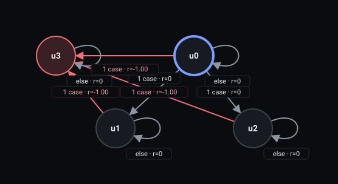
<details><summary>RM text</summary>
<pre>REWARD_MACHINE:
STATES: u0, u1, u2, u3
INITIAL_STATE: u0
FINAL_STATES:
REJECTING_STATES: u3
DEFAULT_REWARD: 0
TRANSITION_FUNCTION:
(u0, !has_key&amp;key_lost) -&gt; u1
(u0, has_key&amp;!key_lost) -&gt; u2
(u0, has_key&amp;key_lost) -&gt; u3
(u1, has_key) -&gt; u3
(u2, key_lost) -&gt; u3
REWARD_FUNCTION:
(u0, has_key&amp;key_lost, u3) -&gt; -1
(u1, has_key, u3) -&gt; -1
(u2, key_lost, u3) -&gt; -1</pre>
</details>
</td>
<td valign="top">
<b>Soft, recurrent off</b><br>
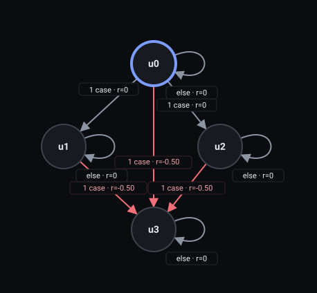
<details><summary>RM text</summary>
<pre>REWARD_MACHINE:
STATES: u0, u1, u2, u3
INITIAL_STATE: u0
FINAL_STATES:
DEFAULT_REWARD: 0
TRANSITION_FUNCTION:
(u0, !has_key&amp;key_lost) -&gt; u1
(u0, has_key&amp;!key_lost) -&gt; u2
(u0, has_key&amp;key_lost) -&gt; u3
(u1, has_key) -&gt; u3
(u2, key_lost) -&gt; u3
REWARD_FUNCTION:
(u0, has_key&amp;key_lost, u3) -&gt; -0.5
(u1, has_key, u3) -&gt; -0.5
(u2, key_lost, u3) -&gt; -0.5</pre>
</details>
</td>
<td valign="top">
<b>Soft, recurrent on (default)</b><br>
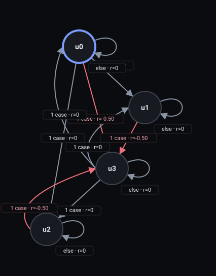
<details><summary>RM text</summary>
<pre>REWARD_MACHINE:
STATES: u0, u1, u2, u3
INITIAL_STATE: u0
FINAL_STATES:
DEFAULT_REWARD: 0
TRANSITION_FUNCTION:
(u0, !has_key&amp;key_lost) -&gt; u1
(u0, has_key&amp;!key_lost) -&gt; u2
(u0, has_key&amp;key_lost) -&gt; u3
(u1, has_key) -&gt; u3
(u2, key_lost) -&gt; u3
(u3, !has_key&amp;!key_lost) -&gt; u0
(u3, !has_key&amp;key_lost) -&gt; u1
(u3, has_key&amp;!key_lost) -&gt; u2
REWARD_FUNCTION:
(u0, has_key&amp;key_lost, u3) -&gt; -0.5
(u1, has_key, u3) -&gt; -0.5
(u2, key_lost, u3) -&gt; -0.5</pre>
</details>
</td>
</tr></table>

**Hard.** The step where the second of the two appears sends the run to the well, −1, and the episode
ends.

**Soft, recurrent off.** That step costs −0.5, once, and `u3` is a trap.

**Soft, recurrent on.** `u3` takes the start state's edges. After a charge the machine forgets
both propositions, not only the one that went away, and reads the next step as a fresh start:

**NotCoExistence, the step after a charge**

| Next step | Soft, recurrent off | Soft, recurrent on (default) |
|---|---|---|
| `-` | u3, 0 | u0, 0 |
| `x` | u3, 0 | u2, 0 |
| `y` | u3, 0 | u1, 0 |
| `xy` | u3, 0 | u3, 0 |

- Next step `x` and not `y`: "`x` seen" (`u2`). Now `x` can come and go freely, and any later `y`
  charges.
- Next step `y` and not `x`: "`y` seen" (`u1`), the mirror case.
- Neither: back to the start (`u0`). Both are forgotten, so a later `y` alone does not charge; it
  needs a new `x` too.
- Both: the machine stays in `u3` and the step is free. A proposition that stays true across the
  charge counts as appearing again.

**NotCoExistence, all traces**

| Trace | Hard | Soft, recurrent off | Soft, recurrent on (default) |
|---|---|---|---|
| `x y` | −1, ends at step 2 (well) | −0.5 (1 charge) | −0.5 (1 charge) |
| `x y x` | −1, ends at step 2 (well) | −0.5 (1 charge) | −0.5 (1 charge) |
| `x y x y` | −1, ends at step 2 (well) | −0.5 (1 charge) | −1 (2 charges) |
| `xy` | −1, ends at step 1 (well) | −0.5 (1 charge) | −0.5 (1 charge) |
| `x y x - y` | −1, ends at step 2 (well) | −0.5 (1 charge) | −1 (2 charges) |
| `x y - y` | −1, ends at step 2 (well) | −0.5 (1 charge) | −0.5 (1 charge) |
| `x y - y x` | −1, ends at step 2 (well) | −0.5 (1 charge) | −1 (2 charges) |
| `x y y x` | −1, ends at step 2 (well) | −0.5 (1 charge) | −1 (2 charges) |
| `x - y` | −1, ends at step 3 (well) | −0.5 (1 charge) | −0.5 (1 charge) |
| `y x` | −1, ends at step 2 (well) | −0.5 (1 charge) | −0.5 (1 charge) |
| `x y - x` | −1, ends at step 2 (well) | −0.5 (1 charge) | −0.5 (1 charge) |
| `x y - x y` | −1, ends at step 2 (well) | −0.5 (1 charge) | −1 (2 charges) |
| `xy x y` | −1, ends at step 1 (well) | −0.5 (1 charge) | −1 (2 charges) |
| `x - x` | 0, no end | 0 (0 charges) | 0 (0 charges) |
| `x x` | 0, no end | 0 (0 charges) | 0 (0 charges) |

**NotCoExistence, trace `x y x y`**

| Step | Labels | Hard | Soft, recurrent off | Soft, recurrent on (default) |
|---|---|---|---|---|
| 1 | `x` | u2, 0 | u2, 0 | u2, 0 |
| 2 | `y` | u3 (well), −1 | u3, −0.5 | u3, −0.5 |
| 3 | `x` | — | u3, 0 | u2, 0 |
| 4 | `y` | — | u3, 0 | u3, −0.5 |
| **Total** | | −1 | −0.5 (1 charge) | −1 (2 charges) |

**NotCoExistence, trace `x y x - y`**

| Step | Labels | Hard | Soft, recurrent off | Soft, recurrent on (default) |
|---|---|---|---|---|
| 1 | `x` | u2, 0 | u2, 0 | u2, 0 |
| 2 | `y` | u3 (well), −1 | u3, −0.5 | u3, −0.5 |
| 3 | `x` | — | u3, 0 | u2, 0 |
| 4 | `-` | — | u3, 0 | u2, 0 |
| 5 | `y` | — | u3, 0 | u3, −0.5 |
| **Total** | | −1 | −0.5 (1 charge) | −1 (2 charges) |

The second trace is the one that confuses most. After the charge at step 2, `x` (step 3) is "`x`
seen", and the `-` of step 4 does not forget it: only the step right after a charge is a fresh start.
The `y` of step 5 charges again, so `x y x - y` is 2. The next two traces show the fresh start:

**NotCoExistence, trace `x y - y`**

| Step | Labels | Hard | Soft, recurrent off | Soft, recurrent on (default) |
|---|---|---|---|---|
| 1 | `x` | u2, 0 | u2, 0 | u2, 0 |
| 2 | `y` | u3 (well), −1 | u3, −0.5 | u3, −0.5 |
| 3 | `-` | — | u3, 0 | u0, 0 |
| 4 | `y` | — | u3, 0 | u1, 0 |
| **Total** | | −1 | −0.5 (1 charge) | −0.5 (1 charge) |

**NotCoExistence, trace `x y - y x`**

| Step | Labels | Hard | Soft, recurrent off | Soft, recurrent on (default) |
|---|---|---|---|---|
| 1 | `x` | u2, 0 | u2, 0 | u2, 0 |
| 2 | `y` | u3 (well), −1 | u3, −0.5 | u3, −0.5 |
| 3 | `-` | — | u3, 0 | u0, 0 |
| 4 | `y` | — | u3, 0 | u1, 0 |
| 5 | `x` | — | u3, 0 | u3, −0.5 |
| **Total** | | −1 | −0.5 (1 charge) | −1 (2 charges) |

In `x y - y`, the `-` right after the charge forgets both, so the `y` alone starts "`y` seen" and
charges nothing (1). In `x y - y x`, the `x` that follows meets "`y` seen" and charges (2). The order
does not matter: `x y y x` also gives 2, since the `y` straight after the charge is read from the
start as "`y` seen" and the `x` after it charges. `xy x y` shows the stay-true case: the first step
holds both, so the charge is at step 1 and the machine stays broken; the `x` then starts "`x` seen"
and the `y` charges again (2). The summary lists every trace.

**Why there is no edge from "`x` seen" back to the start.** Such an edge, taken when `x` goes
away, would make a different rule and not a completed recurrent one. The plain rule (switch off)
already has the same memory: `x - y` charges before any re-arm, because "`x` seen" outlasts the
key. An edge back would drop that memory, so it would change the first charge as well. The rule would
read "a loss counts only while the key is still held": "`x` seen" would last only while `x` holds, and
a charge would need both propositions in the same step. The re-arm only rewires the broken-for-good
state. The rule with such edges is `G !(x & y)`, "never in the same step":

**Variant SameStep next to the template, hard result and charges recurrent on / off**

| Trace | NotCoExistence | Variant SameStep |
|---|---|---|
| `x y` | −1, ends at step 2 (well); charges 1 / 1 | 0, no end; charges 0 / 0 |
| `x - y` | −1, ends at step 3 (well); charges 1 / 1 | 0, no end; charges 0 / 0 |
| `xy` | −1, ends at step 1 (well); charges 1 / 1 | −1, ends at step 1 (well); charges 1 / 1 |
| `xy x xy` | −1, ends at step 1 (well); charges 2 / 1 | −1, ends at step 1 (well); charges 2 / 1 |

In that rule `x y` and `x - y` are free, and only `xy` charges. It is a valid formula, and not one of
the eight templates.

**In DoorKey it charges once per real loss.** `key_lost` is true only right after a step with
`has_key` ([`environment.md:24`](../../../examples/arm-fm/minigrid-doorkey/environment.md)), so every
`y` comes straight after an `x`, and `has_key` can turn false without `key_lost` only after the door is
open (line 42). So NotCoExistence(has_key, key_lost) charges exactly once per real loss, and charges the
same losses as Absence(key_lost). With a goal, the per-step rewards can differ slightly through the
progress term.

**DoorKey episodes, charges recurrent on / off**

| Trace | DoorKey episode | NotCoExistence(has_key, key_lost) | Absence(key_lost) |
|---|---|---|---|
| `x y` | pick up the key, drop it | 1 / 1 | `- x`: 1 / 1 |
| `x y x y` | pick up, drop, pick up, drop | 2 / 1 | `- x - x`: 2 / 1 |
| `x y x y x y` | pick up, drop, three times | 3 / 1 | `- x - x - x`: 3 / 1 |
| `x x -` | pick up, open the door, drop (door open: no key_lost) | 0 / 0 | `- - -`: 0 / 0 |

**What it does not mean.**

- *"Never in the same step."* That is `G !(x & y)`, the variant of the table above. It charges `xy`
  and not `x y`. In DoorKey it would never fire, since `key_lost` and `has_key` never hold together
  ([`environment.md:33`](../../../examples/arm-fm/minigrid-doorkey/environment.md)).
- *"A loss counts only while the key is still held."* The same rule: the missing edge discussed
  above makes it.
- *"Charge every step in which both have appeared."* Not done: a step after a charge that keeps
  both true is free (`xy` in the exit table), so a break is counted once, when it happens.

## Rerun

From the repository root, inside `RM_RL_env`:

```bash
PYTHONPATH=app python -W ignore docs/paper/clause-semantics/check/clause_semantics.py
```

It compiles every machine, walks every trace of `check/traces.json`, and prints its last lines, for
example `OK: all assertions hold; wrote traces.txt and graphs/`. It stops with a message when an
asserted charge count differs, or when a table pasted in this README differs from `traces.txt`.
No language model is called. The files are:

- `check/clause_semantics.py`: the script. `check/traces.json`: the traces, the asserted counts and
  the counter-case formulas.
- `check/traces.txt`: the full output, with every machine, legend and trace table.
- `check/graphs/`: one SVG and one `.rm` text per distinct machine, drawn by the repository's
  `app/scripts/render_rm.py`. It also holds the machines next to the goal and those of the
  counter-case formulas (`Variant.*`).
