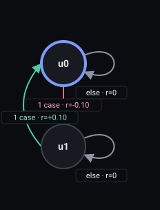

# Reward Machine pipeline report

One accepted attempt per task; each sub-step is the pipeline's own artifact
output, rendered deterministically in fixed order.

Recurrent soft rules: on

## Task 1 — `Whenever you drop the key, pick it up again`

Accepted on attempt 1; output `l1_4-run1.rm`.

#### 1. Validated proposal (clauses)

```json
[
  {
    "normalized_clause": "Whenever the key is lost, the key is picked up again",
    "pattern": "Response",
    "priority": "hard",
    "propositions": [
      "key_lost",
      "has_key"
    ]
  }
]
```

#### 2. LTLf formulas

```json
[
  {
    "formula": "(G(key_lost->(Fhas_key)))",
    "normalized_clause": "Whenever the key is lost, the key is picked up again"
  }
]
```

#### 3. MONA DFA

```text
accepting_states: S2
alphabet: has_key, key_lost
initial_state: S1
states: S1, S2, S3
transitions:
  (S1, !has_key&!key_lost) -> S2
  (S1, !has_key&key_lost) -> S3
  (S1, has_key) -> S2
  (S2, !has_key&!key_lost) -> S2
  (S2, !has_key&key_lost) -> S3
  (S2, has_key) -> S2
  (S3, !has_key) -> S3
  (S3, has_key) -> S2
```

#### 4. Compiled Reward Machine

<table><tbody><tr><td><pre>REWARD_MACHINE:
STATES: u0, u1
INITIAL_STATE: u0
FINAL_STATES:
ACCEPTING_STATES: u0
DEFAULT_REWARD: 0
HARD_FAILED_REWARD: -1
SOFT_FAILED_REWARD: -0.5
TRANSITION_FUNCTION:
(u0, !has_key&amp;key_lost) -&gt; u1
(u1, has_key) -&gt; u0
REWARD_FUNCTION:
(u0, !has_key&amp;key_lost, u1) -&gt; -0.1
(u1, has_key, u0) -&gt; 0.1
PENDING_PROMISES:
u1: hard 1, soft 0
</pre></td><td><a href="steps-svgs/task-1.svg"></a></td></tr></tbody></table>

#### 5. State descriptions

```json
{
  "u0": "No promise is outstanding here: either the key has not just been dropped, or it has already been picked up again after a drop. The agent remains free to move about, and if it drops the key while empty-handed before the door is open, it will owe an immediate recovery; keeping the key, opening the door, and reaching the goal all stay available.",
  "u1": "The key was just dropped while the door was still closed, so the agent must pick it back up. Until it is carrying the key again this obligation stays open, and ending the episode now would count as a hard failure; picking the key up clears the debt and returns to normal progress, after which opening the door and reaching the goal remain."
}
```

#### 6. MiniGrid labeling source

skipped (disabled for this run)

#### 7. State embeddings

skipped (disabled for this run)

#### 8. Critic verdict

```json
{
  "accepted": true,
  "feedback": "NO CHANGES NEEDED"
}
```
