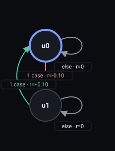

# Reward Machine pipeline report

One accepted attempt per task; each sub-step is the pipeline's own artifact
output, rendered deterministically in fixed order.

Recurrent soft rules: on

## Task 1 — `Whenever you drop the key, pick it up again`

Accepted on attempt 1; output `l1_4-run2.rm`.

#### 1. Validated proposal (clauses)

```json
[
  {
    "normalized_clause": "Whenever you drop the key, pick it up again",
    "pattern": "Response",
    "priority": "hard",
    "propositions": [
      "key_lost",
      "has_key"
    ]
  }
]
```

#### 2. LTLf formulas

```json
[
  {
    "formula": "(G(key_lost->(Fhas_key)))",
    "normalized_clause": "Whenever you drop the key, pick it up again"
  }
]
```

#### 3. MONA DFA

```text
accepting_states: S2
alphabet: has_key, key_lost
initial_state: S1
states: S1, S2, S3
transitions:
  (S1, !has_key&!key_lost) -> S2
  (S1, !has_key&key_lost) -> S3
  (S1, has_key) -> S2
  (S2, !has_key&!key_lost) -> S2
  (S2, !has_key&key_lost) -> S3
  (S2, has_key) -> S2
  (S3, !has_key) -> S3
  (S3, has_key) -> S2
```

#### 4. Compiled Reward Machine

<table><tbody><tr><td><pre>REWARD_MACHINE:
STATES: u0, u1
INITIAL_STATE: u0
FINAL_STATES:
ACCEPTING_STATES: u0
DEFAULT_REWARD: 0
HARD_FAILED_REWARD: -1
SOFT_FAILED_REWARD: -0.5
TRANSITION_FUNCTION:
(u0, !has_key&amp;key_lost) -&gt; u1
(u1, has_key) -&gt; u0
REWARD_FUNCTION:
(u0, !has_key&amp;key_lost, u1) -&gt; -0.1
(u1, has_key, u0) -&gt; 0.1
PENDING_PROMISES:
u1: hard 1, soft 0
</pre></td><td><a href="steps-svgs/task-1.svg"></a></td></tr></tbody></table>

#### 5. State descriptions

```json
{
  "u0": "The agent is not currently under any outstanding obligation regarding the key: either it still holds the key or it has not just lost it. No dropped-key promise is pending. From here, if the key is dropped before the door is open, the machine records an outstanding promise to recover it.",
  "u1": "The agent has dropped the key while the door is closed, creating an outstanding obligation to pick the key up again. Successful recovery means holding the key once more; until then the obligation remains pending, and the episode ends in failure if it is never fulfilled."
}
```

#### 6. MiniGrid labeling source

skipped (disabled for this run)

#### 7. State embeddings

skipped (disabled for this run)

#### 8. Critic verdict

```json
{
  "accepted": true,
  "feedback": "NO CHANGES NEEDED"
}
```
