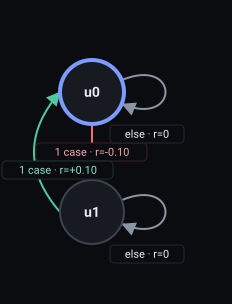

# Reward Machine pipeline report

One accepted attempt per task; each sub-step is the pipeline's own artifact
output, rendered deterministically in fixed order.

Recurrent soft rules: on

## Task 1 — `Whenever you drop the key, pick it up again`

Accepted on attempt 1; output `l1_4-run3.rm`.

#### 1. Validated proposal (clauses)

```json
[
  {
    "normalized_clause": "Whenever the agent drops the key, it must pick it up again at some later step",
    "pattern": "Response",
    "priority": "hard",
    "propositions": [
      "key_lost",
      "has_key"
    ]
  }
]
```

#### 2. LTLf formulas

```json
[
  {
    "formula": "(G(key_lost->(Fhas_key)))",
    "normalized_clause": "Whenever the agent drops the key, it must pick it up again at some later step"
  }
]
```

#### 3. MONA DFA

```text
accepting_states: S2
alphabet: has_key, key_lost
initial_state: S1
states: S1, S2, S3
transitions:
  (S1, !has_key&!key_lost) -> S2
  (S1, !has_key&key_lost) -> S3
  (S1, has_key) -> S2
  (S2, !has_key&!key_lost) -> S2
  (S2, !has_key&key_lost) -> S3
  (S2, has_key) -> S2
  (S3, !has_key) -> S3
  (S3, has_key) -> S2
```

#### 4. Compiled Reward Machine

<table><tbody><tr><td><pre>REWARD_MACHINE:
STATES: u0, u1
INITIAL_STATE: u0
FINAL_STATES:
ACCEPTING_STATES: u0
DEFAULT_REWARD: 0
HARD_FAILED_REWARD: -1
SOFT_FAILED_REWARD: -0.5
TRANSITION_FUNCTION:
(u0, !has_key&amp;key_lost) -&gt; u1
(u1, has_key) -&gt; u0
REWARD_FUNCTION:
(u0, !has_key&amp;key_lost, u1) -&gt; -0.1
(u1, has_key, u0) -&gt; 0.1
PENDING_PROMISES:
u1: hard 1, soft 0
</pre></td><td><a href="steps-svgs/task-1.svg"></a></td></tr></tbody></table>

#### 5. State descriptions

```json
{
  "u0": "No key drop is currently outstanding: the agent is either holding the key or has never dropped it before opening the door. From here, dropping the key while not carrying it would open an obligation to retrieve it.",
  "u1": "The agent dropped the yellow key before the door was opened and has not yet picked it up again. Picking the key back up at any later step clears this outstanding obligation and returns the agent to the settled state; leaving it unretrieved until the episode ends counts as a violation."
}
```

#### 6. MiniGrid labeling source

skipped (disabled for this run)

#### 7. State embeddings

skipped (disabled for this run)

#### 8. Critic verdict

```json
{
  "accepted": true,
  "feedback": "NO CHANGES NEEDED"
}
```
