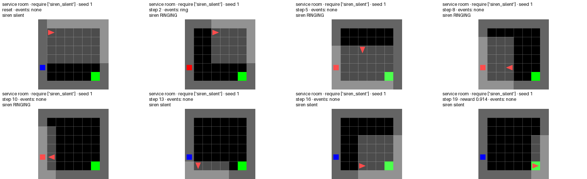
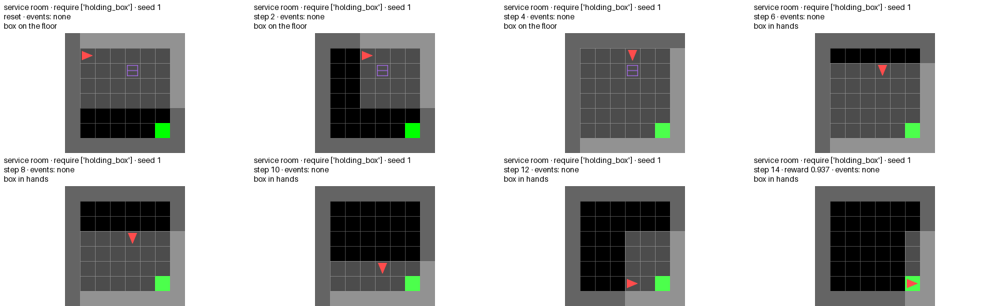
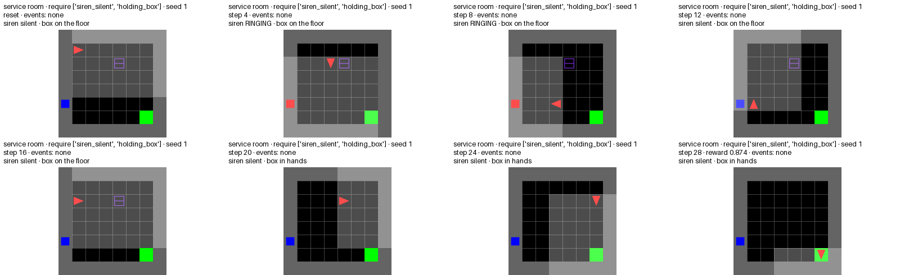

# Event room: a small environment where things happen to the agent

Date: 2026-11-12, from the S3 slice of the testing program (check rerun on the wave head `7ae1157`).
Everything here opens from disk.

## What it shows

The benchmark needs rules that react to events the agent does not cause: a siren that rings, a box
that slips out of the agent's hands. No MiniGrid room has them, so the program added
`MiniGrid-ServiceRoom-v0` (`app/src/arm_fm/service_room.py`): one 8 x 8 room with an exit, a box and a
wall switch. The layout never changes; only the event schedule is random, seeded per episode. The
sheets and GIFs below are the visual proof that the events happen, that the agent can answer them, and
that answering them is what earns the exit reward. A scripted policy (hand-written, not learned) plays
50 seeded episodes in each of four setups: **200 of 200 episodes end at the exit with reward above 0**.
This shows the room works and is solvable. It does not show that an agent can learn to solve it.

## The tasks

| Setup | Natural-language task | LTL | Reward Machine |
| --- | --- | --- | --- |
| siren | Go to the exit, and whenever the siren rings, turn it off. | `F at_exit` and `G (siren_ringing -> F switch_toggled)` | [graph](graphs/cx-siren.html), [text](graphs/cx-siren.rm.txt) (FARM, card `cx-siren`) |
| box | Go to the exit, and whenever the box falls, pick it up again. | `F at_exit` and `G (box_fell -> F holding_box)` | [graph](graphs/cx-box.html), [text](graphs/cx-box.rm.txt) (FARM, card `cx-box`) |
| both | Reach the exit; if the siren rings, silence it with the switch, and if the box falls, pick it up again. | `F at_exit & G(siren_ringing -> F switch_toggled) & G(box_fell -> F holding_box)` | none generated; the sheet shows the trace |
| neither | Reach the exit. | `F at_exit` | none |

The two machines are what FARM generated for the two event-room cards in the LI.2 smoke (4 states
each, replay 6/6); they are shown to give the sheets a machine, and they were not used to drive the
scripted policy. The "both" and "neither" setups have no generated machine. The siren machine, as text:

```text
STATES: u0, u1, u2, u3        INITIAL_STATE: u0        FINAL_STATES: u2
(u0, !at_exit&siren_ringing&!switch_toggled) -> u1     reward -0.1   (the siren starts: a promise opens)
(u1, !at_exit&switch_toggled) -> u0                    reward  0.1   (the agent silences it: paid back)
(u0, at_exit&!siren_ringing) -> u2                     reward  1.1
(u1, at_exit&switch_toggled) -> u2                     reward  1.2
...  (full text and the graph in graphs/)
```

## Results

| Setup | Scripted episodes | Reach the exit with reward > 0 | Mean reward | Wrong variant (policy ignores the events) |
| --- | --- | --- | --- | --- |
| siren | 50 | 50 | 0.901 | ignoring the siren: 0 of 50, reward 0 |
| box | 50 | 50 | 0.934 | ignoring the fall: 0 of 50, reward 0 |
| both | 50 | 50 | 0.841 | ignoring either: 0 of 50 each, reward 0 |
| neither | 50 | 50 | 0.951 | none |

The exit pays 1 minus 0.9 times the fraction of the 200-step limit used, but only when the setup's
condition holds there (siren silent, box in hands). That is why the ignoring variants earn 0 while
still reaching the exit. Other checks in `check/summary.json` (42 in all, all pass): every toggle of
the switch matches a fired ring, after each fall the hands are empty and the box is next to the agent,
the same seed replays the same episode, and the observation changes in one cell only (`[2, 2, 0]`
silent, `[2, 0, 0]` ringing).

## Sheets and GIFs

| Setup | Frame sheet (seed 1) | GIFs |
| --- | --- | --- |
| siren |  | [seed 1](gifs/siren-seed1.gif), [seed 2](gifs/siren-seed2.gif) |
| box |  | [seed 1](gifs/box-seed1.gif), [seed 2](gifs/box-seed2.gif) |
| both |  | [seed 1](gifs/both-seed1.gif), [seed 2](gifs/both-seed2.gif) |
| neither | none | [seed 1](gifs/neither-seed1.gif), [seed 2](gifs/neither-seed2.gif) |

## Files

- `sheets/`, `gifs/`: the frame sheets and GIFs (from the S3 coder's run, kept as they were viewed).
- `graphs/`: the two FARM machines for the siren and box cards, as live HTML, SVG and RM text.
- `check/summary.json`: the output of the check on the wave head (rerun on 2026-11-12 12:29 CET).

## Rerun

From the repository root, inside `RM_RL_env`; no LLM call:

```bash
PYTHONPATH=app python -W ignore experiments/benchmark/scripts/check_service_room.py --out <output dir>
```

It ends with `all 42 checks passed; summary and GIFs in <output dir>` and writes `summary.json` and two
GIFs per setup there. The eight GIFs of this entry are byte-identical to the ones the rerun wrote on
2026-11-12 (compared with `cmp`).

## Code

`app/src/arm_fm/service_room.py`, the env files `experiments/benchmark/envs/service-room/`, the check
`experiments/benchmark/scripts/check_service_room.py`. The slice merged into the wave as commit
`09d7455` (`merge: tp-s3-event-room`).
