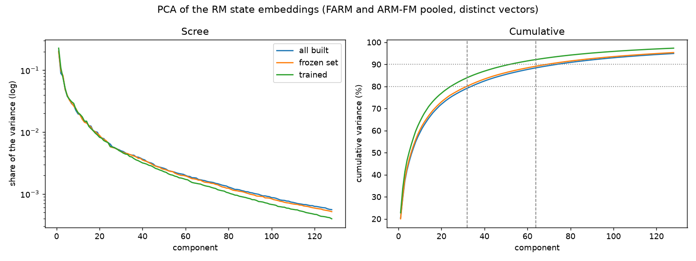

# State-embedding similarity inside a Reward Machine

The agent sees an RM state as the embedding of its state description (`nomic-embed-text`, 768 values). This entry
measures how close those embeddings are inside one machine, FARM and ARM-FM, and what the same model gives for
states of different machines, and how many principal components hold 80% and 90% of their variance (section "PCA of
the state vectors"). No model call, no training: it reads the `embeddings.json` of the bundles.

## What it shows

For each machine with 2 or more embedded states, each state's nearest other state (highest cosine) and the mean
cosine over all state pairs. Per arm and machine set, the mean over machines, with the lowest and highest machine.

| arm | RM set | RMs | median states | nearest other state, mean (min to max) | all pairs, mean | states of other RMs, mean (lowest pair) |
|---|---|---|---|---|---|---|
| FARM | all built | 288 | 4 | 0.891 (0.763 to 0.951) | 0.855 | 0.662 (0.359) |
| FARM | frozen set | 260 | 4 | 0.891 (0.763 to 0.951) | 0.858 | 0.662 (0.359) |
| FARM | trained | 51 | 4 | 0.890 (0.822 to 0.939) | 0.852 | 0.645 (0.392) |
| ARM-FM | all built | 182 | 4 | 0.844 (0.692 to 0.914) | 0.779 | 0.665 (0.359) |
| ARM-FM | frozen set | 152 | 4 | 0.845 (0.692 to 0.914) | 0.782 | 0.700 (0.430) |
| ARM-FM | trained | 31 | 4 | 0.845 (0.692 to 0.903) | 0.776 | 0.692 (0.476) |
| pooled | all built | 470 | 4 | 0.873 (0.692 to 0.951) | 0.826 | 0.648 (0.334) |
| pooled | frozen set | 412 | 4 | 0.874 (0.692 to 0.951) | 0.830 | 0.656 (0.346) |
| pooled | trained | 82 | 4 | 0.873 (0.692 to 0.939) | 0.823 | 0.639 (0.359) |

- **Pooled row.** FARM and ARM-FM together, one figure for both arms: the nearest-other and all-pairs means are
  taken over the RMs of both arms (RM-weighted, so the trained 0.873 is (51 x 0.890 + 31 x 0.845) / 82), and the
  "other RMs" baseline pairs every state of two different RMs, FARM-to-ARM-FM pairs included. An RM both arms built
  in identical form stays two RMs, as each arm's set already counts it.
- **Same result in every set.** FARM's nearest other state sits at 0.89 and ARM-FM's at 0.84 to 0.85, so the choice of
  set does not move the thesis figure. At two decimals ARM-FM reads 0.84 over all built bundles and 0.85 (0.845) over
  the frozen set and the trained machines.
- **The three sets** (the machines with fewer than 2 embedded states cannot have a nearest other state and are left
  out of the counts):
  - `all built`: every `experiments/benchmark/*/bundles/{farm,arm-fm}/*/embeddings.json` (294 FARM and 276 ARM-FM
    files; 288 and 182 have 2 or more states). It adds to the frozen set the ARM-FM paper and XLand baselines (3 and 8
    per arm), one box-carry side bundle per arm, the FARM shop side bundles (16) and the pre-freeze ARM-FM shop
    machines (18).
  - `frozen set`: the bundles each arm was asked for in the final run and built (status complete), from
    `docs/paper/reward-loops-and-rounds/evidence/bundles.json`: 265 FARM and 152 ARM-FM; 260 FARM and all 152 ARM-FM
    have 2 or more states. The 5 FARM machines left out have a single state: `tpl-absence-soft-1-nogoal` and its
    three rewordings, and `tpl-not-co-existence-soft-1-nogoal`.
  - `trained`: the machines of the final runs that were judged: the bundle named by `run-config.yaml` of
    `outputs/runs/bench__<suite>__<card>__<arm>__ppo` (suites base, pilot, complex, templates, box-carry, forced-start,
    forcing, shop, shop-reward), with at least one judged seed folder (not renamed), and the bundle in the frozen set.
    Cards that train on another card's machine (the box-carry copies) count that machine once. 53 FARM and 31 ARM-FM
    machines; two FARM ones have one state (`tpl-absence-soft-1-nogoal`, `tpl-not-co-existence-soft-1-nogoal`).
- **Machines are small.** The median machine has 4 states, and a machine of 2 states has one pair, so its nearest
  other state is that pair. The nearest-other figure is a maximum, so it rises with the number of states.
- **Baseline for the caveat.** "States of other RMs" is the cosine over every pair of states that belong to two
  different machines of the same arm and set (1,692 FARM and 819 ARM-FM states in `all built`, so every pair is used,
  no sampling and no seed). It is 0.64 to 0.70 on average and 0.36 to 0.48 for the lowest pair. States of different
  machines still describe tasks in the same few environments, so this is the model's range on related text, not a
  floor for unrelated sentences. For the thesis: the model already gives 0.64 to 0.70 to states of other machines, so
  a nearest-other-state cosine of 0.89 (FARM) and 0.85 (ARM-FM) means close states, with a gap above what other machines
  score of 0.23 for FARM and 0.15 for ARM-FM (frozen set).

## Suggested wording

"Over the 260 FARM and 152 ARM-FM Reward Machines of the benchmark that have at least two states, the mean cosine
similarity between the embedding of a state and that of its nearest state in the same machine is 0.89 for FARM and
0.85 for ARM-FM. States of different machines of the same arm score 0.66 (FARM) and 0.70 (ARM-FM) on average."

## PCA of the state vectors

How many of the 768 dimensions do the state embeddings use? A PCA over the distinct state vectors of each RM set,
FARM and ARM-FM pooled (a vector counts once; exact copies are dropped, 1 in 2,516). It reruns the 17 November
whole-corpus study (1,883 vectors: 80% at 32 components, 89% at 64, broken stick 37) on the final bundles; the
functions give those old numbers exactly when run on its corpus.

| RM set | RMs | distinct vectors | rank (of 768) | 80% at | 90% at | variance at 32 | variance at 64 | broken stick | bootstrap 80% median (95%) | bootstrap 90% median (95%) | stable |
|---|---|---|---|---|---|---|---|---|---|---|---|
| all built | 475 | 2515 | 768 | 34 | 74 | 79.2% | 88.4% | 37 | 33 (33 to 35) | 72 (70 to 73) | yes |
| frozen set | 417 | 2141 | 768 | 32 | 70 | 80.1% | 89.2% | 37 | 31 (30 to 33) | 67 (66 to 69) | yes |
| trained | 84 | 471 | 470 | 25 | 52 | 84.0% | 92.2% | 24 | 23 (22 to 24) | 47 (44 to 49) | no |

- **Reading.** Over the frozen set (2,141 vectors, full rank), 32 components hold 80.1% of the variance, 64 hold
  89.2% and 90% needs 70. All built gives 34 and 74. The 17 November corpus gave 32 and 69, so the final bundles
  agree with it. The broken stick keeps the first 37 components and calls the rest noise, 37 again.
- **Stability test.** A bootstrap resamples the RMs with replacement (200 times, seed 0), drops copies again and
  refits: the 80% count moves between 30 and 33 for the frozen set and the 90% count between 66 and 69. A set is
  `stable` when its fit has the full rank 768 and, for both counts, the 95% interval is at most 20% of the full-fit
  count wide and the median at most 10% away from it (`stable rule` in the JSON). All built and frozen set pass.
- **Caveat: `trained` is too small.** It has 471 distinct vectors, so its rank is at most 470 of 768 and the fit
  cannot see most directions. Its counts (25 and 52) sit below the large sets' (32 and 70) by more than its own
  bootstrap spread, and 32 components already hold 84%. Counts grow with the number of vectors (every bootstrap median
  sits 1 to 5 under its full fit because a resample holds fewer distinct vectors), so do not quote the `trained` row.
  Quote the frozen set, with "about". Never fit on one environment: the 17 November note found 78 vectors, rank 77,
  too few.
- **What it does not show.** Variance held is a statement about the stored vectors. It does not show that an agent
  keeps learning with fewer features.

Suggested wording: "A principal component analysis of the 2,141 distinct state embeddings of the benchmark Reward
Machines (FARM and ARM-FM together) shows that 32 of the 768 dimensions hold 80% of the variance and about 70 hold
90%."

## Gaps

- The `trained` set is the machines with a judged final run, not the machines that learned; and `outputs/runs` is not in
  git, so that set can be rerun only in the checkout that holds the runs. Its list is in
  `evidence/state-similarity.json` (`trained bundles`).
- Cosine here is on the vectors stored in the bundles (unit length by manifest `normalize: true`; the script
  normalizes again). Every bundle with an embedded state has `nomic-embed-text`, 768 values, read from each manifest
  (`effective_settings.embedding`); the script stops if a vector's size differs from its manifest.
- Means over machines weight each machine equally; the "states of other RMs" mean weights each pair equally, so large
  machines (up to 65 states, FARM shop) weigh more in it.

## Files

- `check/rm_sets.py`: the three RM sets and the vector reader both scripts import.
- `check/state_similarity.py`: reads the bundles and run configs, writes the two files below and prints the table.
- `check/state_pca.py`: the PCA, its bootstrap and the stability flag; writes the three PCA files below.
- `evidence/state-similarity.json`: the summary per arm and set (and pooled), the trained bundle list and one row per machine
  (path, state count, nearest-other mean, all-pairs mean).
- `evidence/state-similarity.md`: the table above, as the script writes it.
- `evidence/state-pca.json`, `.md` and `.png`: the PCA table with the bootstrap spread and the stable rule, and the
  scree and cumulative plot.

## Rerun

From the repository root, inside `RM_RL_env` (numpy and the standard library for the similarity, plus matplotlib for
the PCA plot; no model call). Both need the main checkout that holds `outputs/runs`. No `-I`: the scripts import
`rm_sets.py` from their own folder.

    /home/turbotowerlnx/miniconda3/envs/RM_RL_env/bin/python docs/paper/state-embedding-similarity/check/state_similarity.py
    env OMP_NUM_THREADS=4 OPENBLAS_NUM_THREADS=4 /home/turbotowerlnx/miniconda3/envs/RM_RL_env/bin/python docs/paper/state-embedding-similarity/check/state_pca.py

The first prints `embedding model and dimension: nomic-embed-text 768` and the table; the second prints the same line
and the PCA table. The PCA is deterministic (bootstrap seed 0; two runs wrote identical files). With 4 threads it takes
about 23 seconds. The thread limit matters when other jobs run: with numpy's default of one thread per core on a busy
24-core machine (load 40) the 600 refits had not finished after 3 minutes.

## Code

The state vectors are the bundle's `embeddings.json`, read by `RewardMachineObservation` in
`app/src/arm_fm/environments.py`. The pipeline is the freeze `809dfe3`: the manifest stamp of every FARM machine of
the frozen set (260 of 260) and of 143 of the 152 ARM-FM ones is that commit (7 are `68b904d`, 2 are `029d82c`). The
bundles are as on main `7a005656` (`experiments/benchmark/*/bundles`), measured 2026-11-24. The root's throwaway
script was `chain-compare-20261124/state_cosine.py` in the plan folder; its figures (288 FARM and 182 ARM-FM machines,
0.89 and 0.84) are the `all built` rows.
