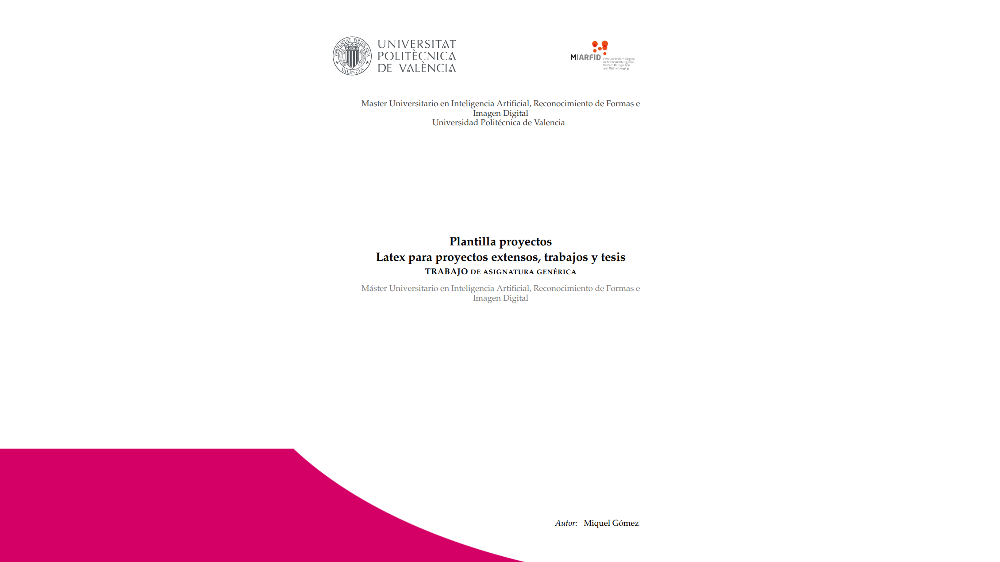
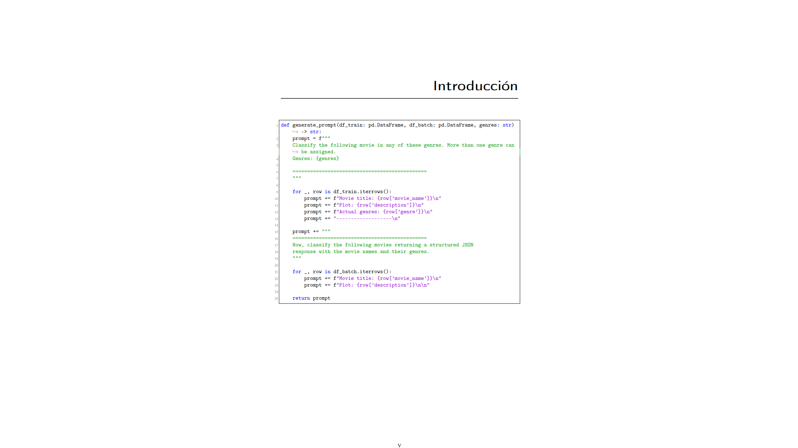
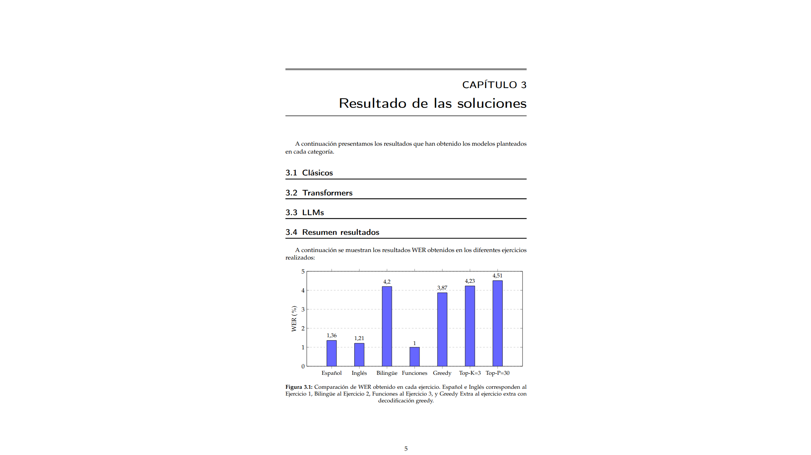
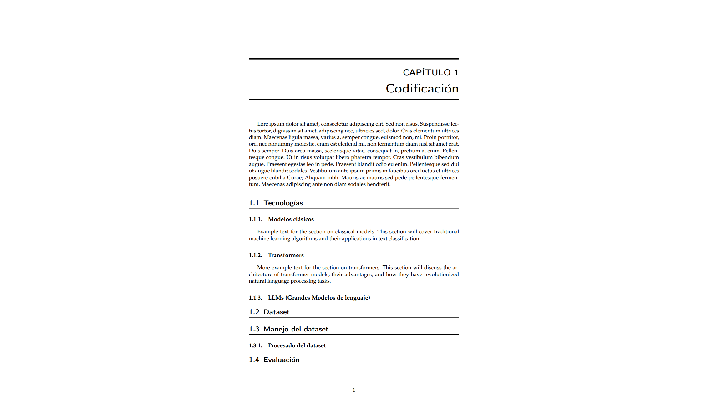
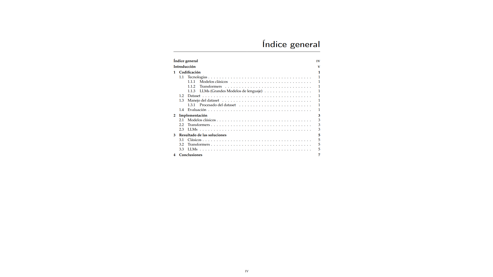

# UPV/ETSINF Thesis Template (Unofficial Enhanced Version)

[English](#english) | [Español](#español)

---

## English

### About this project
This is a modified version of the LaTeX template for Bachelor's (TFG) and Master's (TFM) Theses, originally provided by the School of Informatics (ETSINF) at the Universitat Politècnica de València (UPV).

This repository allows you to start your thesis with a clean, organized foundation. While it inherits the core styling from the university's official files to ensure compliance with formatting rules, it reorganizes the file structure to make it easier to work with using modern tools.

### Key improvements
Unlike the raw files from the university website, this template includes:
* **Git-ready setup:** Includes a pre-configured `.gitignore` file to exclude LaTeX build artifacts, keeping your repository clean.
* **Better organization:** Folders are structured logically for chapters, images, and bibliography.
* **Template functionality:** You can instantiate a new repository directly from this one without manually copying files.

### How to use
1. Click the **Use this template** button at the top of the repository page.
2. Choose **Create a new repository**.
3. Clone your new repo and start editing the `main.tex` file.

### Recommended Setup
To get the most out of this template, I highly recommend running LaTeX locally:

1. **Install a compiler:** Search for a tutorial on how to install a LaTeX distribution for your operating system (like TeX Live for Linux/Windows or MacTeX for macOS).
2. **Use an IDE with sync:** I recommend using Visual Studio Code with the "LaTeX Workshop" extension (or a similar IDE). This enables features like side-by-side editing and "synctex," which lets you jump directly from a specific part of the PDF to the corresponding line in your code and vice versa.

### Attribution and Disclaimer
This is an unofficial adaptation. The core layout, style definitions, and academic standards belong to the Universitat Politècnica de València.

* **Original Source:** [ETSINF TFG/TFM Information Page](https://www.upv.es/entidades/etsinf/trabajo-fin-de-grado-2/)
* **License:** Usage of this template must comply with the licensing and regulations specified by the UPV.

---

## Español

### Sobre este proyecto
Esta es una versión modificada de la plantilla LaTeX para Trabajos de Fin de Grado (TFG) y Máster (TFM), provista originalmente por la Escuela Técnica Superior de Ingeniería Informática (ETSINF) de la Universitat Politècnica de València (UPV).

Este repositorio permite iniciar la memoria con una base limpia y organizada. Aunque hereda los estilos principales de los archivos oficiales de la universidad para asegurar el cumplimiento de la normativa, reestructura los archivos para facilitar el trabajo con herramientas modernas.

### Mejoras principales
A diferencia de los archivos originales de la web de la universidad, esta plantilla incluye:
* **Preparado para Git:** Incluye un archivo `.gitignore` preconfigurado para excluir los archivos temporales de compilación LaTeX, manteniendo el repositorio limpio.
* **Mejor organización:** Carpetas estructuradas lógicamente para capítulos, imágenes y bibliografía.
* **Funcionalidad de plantilla:** Puedes crear un repositorio nuevo directamente desde este sin tener que copiar archivos manualmente.

### Cómo usarlo
1. Haz clic en el botón **Use this template** (Usar esta plantilla) en la parte superior de la página del repositorio.
2. Elige **Create a new repository** (Crear un nuevo repositorio).
3. Clona tu nuevo repo y empieza a editar el archivo `main.tex`.

### Configuración recomendada
Para aprovechar al máximo esta plantilla, recomiendo ejecutar LaTeX en local:

1. **Instala un compilador:** Busca un tutorial sobre cómo instalar una distribución de LaTeX para tu sistema operativo (como TeX Live para Linux/Windows o MacTeX para macOS).
2. **Usa un IDE con sincronización:** Recomiendo usar Visual Studio Code con la extensión "LaTeX Workshop" (o un entorno similar). Esto habilita la edición en paralelo y "synctex", que permite saltar directamente desde una parte específica del PDF a la línea de código correspondiente y viceversa.

### Atribución y Aviso
Esta es una adaptación no oficial. El diseño central, las definiciones de estilo y los estándares académicos pertenecen a la Universitat Politècnica de València.

* **Fuente Original:** [Página de información TFG/TFM ETSINF](https://www.upv.es/entidades/etsinf/trabajo-fin-de-grado-2/)
* **Licencia:** El uso de esta plantilla debe cumplir con las licencias y normativas especificadas por la UPV.

---

<!-- portfolio-gallery:start -->
## Gallery

  
  
  
  
  

<!-- portfolio-gallery:end -->
