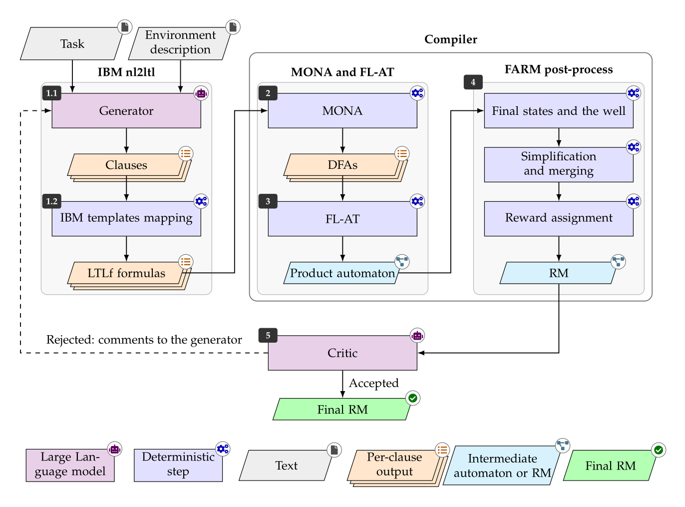

# How the pipeline works

Back to the [main page](../README.md).

Rectangles are processes and slanted boxes are data. A stack stands for one item per clause.
The figure is Figure 3.1 of the thesis, and Chapter 3 explains every step.

## The five steps

1. **Task to formulas.** The generator, a language model, reads the task and the environment
   description and writes the **clauses**. A clause is one of eight fixed templates, the
   propositions that fill it, and a hard or soft priority. Each template has a fixed LTLf
   formula, so a clause becomes a formula with no further guessing.
2. **Formulas to automata.** MONA builds one automaton (DFA) for each formula.
3. **One automaton.** FL-AT joins the automata into one, the product.
4. **The post-process.** FARM sets the final states, simplifies the automaton and assigns the
   rewards. The result is the RM.
5. **The critic.** A second language model checks the RM against the task. If it rejects it,
   its comments go back to the generator, which tries again.

**The language model appears only in Steps 1 and 5.** It never writes a formula, a state, a
transition or a reward. Steps 2 to 4 are the compiler: the same clauses always give the same RM.

## Who does what

| Tool | What FARM uses from it | What FARM leaves out |
| --- | --- | --- |
| [IBM nl2ltl](https://github.com/IBM/nl2ltl) | The eight templates and the formula of each: `Existence`, `ExistenceTwo`, `Absence`, `RespondedExistence`, `Response`, `Precedence`, `ChainResponse`, `NotCoExistence` | Its own prompt and language-model engines. FARM has its own ([engines](../app/src/engines/README.md)) |
| [FL-AT](https://github.com/Jamidd/Flat) | The translation of each formula for MONA, the call to MONA, and the product of the automata | Its other input languages, its rewards and its accepting states |
| [MONA](https://www.brics.dk/mona/) | The automaton of each formula | Everything else |
| This repository | Reading the environment description, the generator and the critic, the post-process (final states, simplification, rewards) and the RM file | It never invents the shape of an automaton. MONA and FL-AT build it |

Hard and soft never change a formula. They only change what the post-process does with the
clause: a hard clause decides when the task is finished or failed, and a soft clause only
changes the rewards.

## What MONA is

MONA is a logic tool, not an AI model. Given a formula, it builds the automaton that accepts
exactly the sequences of events that satisfy it. It reads no natural language, chooses no
propositions and assigns no rewards.

## Read more

- [docs/COMPILER_REWARD_DESIGN.md](../docs/COMPILER_REWARD_DESIGN.md): how the rewards are chosen.
- [docs/NL2LTL_TEMPLATES.md](../docs/NL2LTL_TEMPLATES.md): the templates.
- [docs/LTLF_TASK_LANGUAGE.md](../docs/LTLF_TASK_LANGUAGE.md): the task language.
- [`paper/`](../paper/): the thesis.
