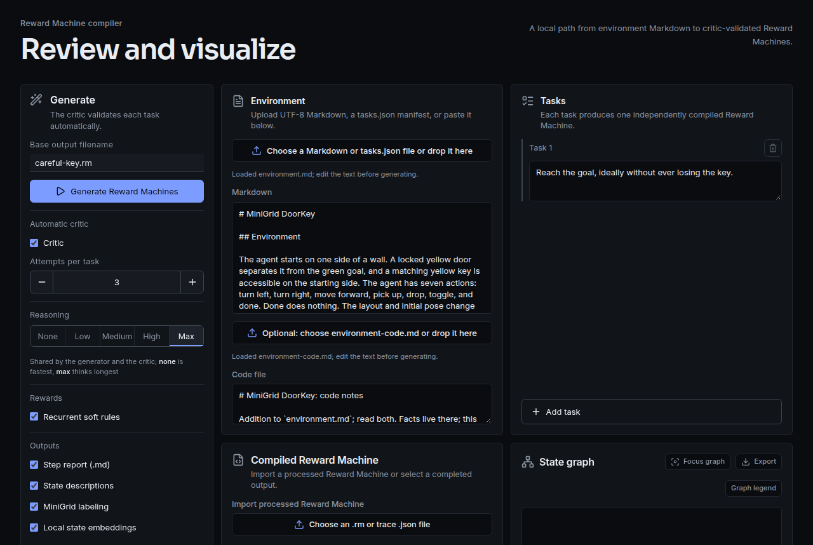
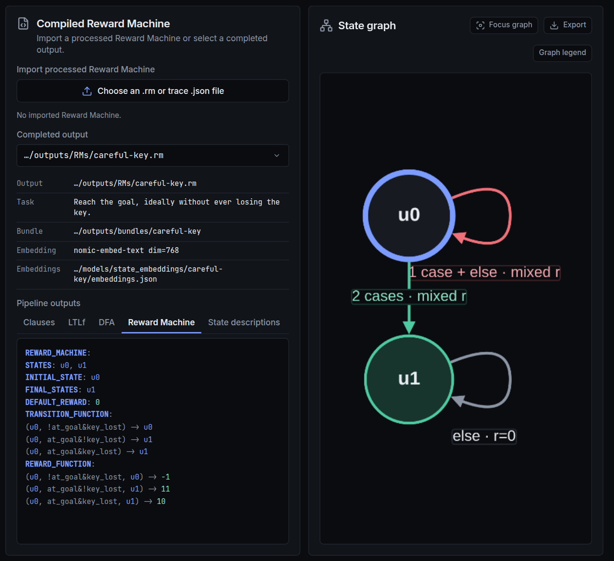
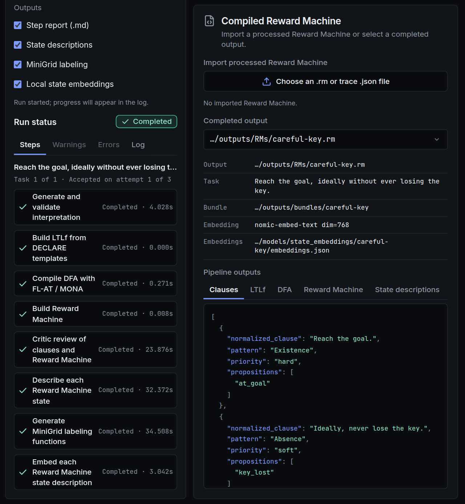
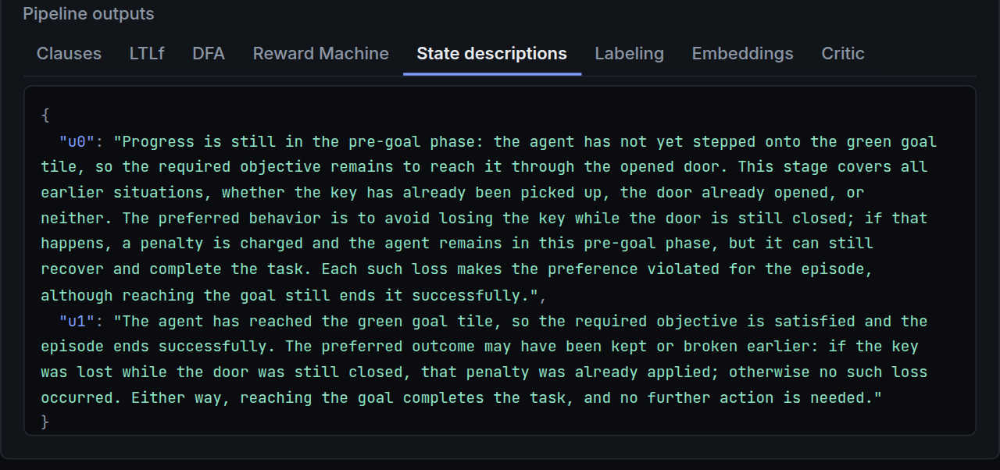
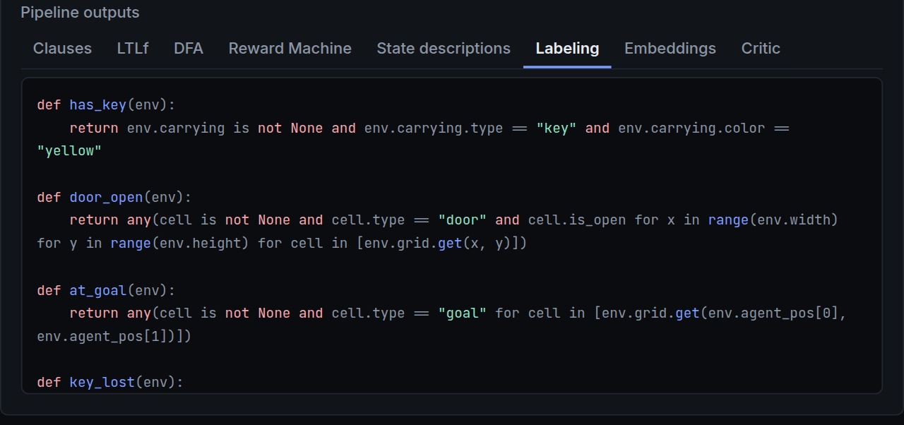
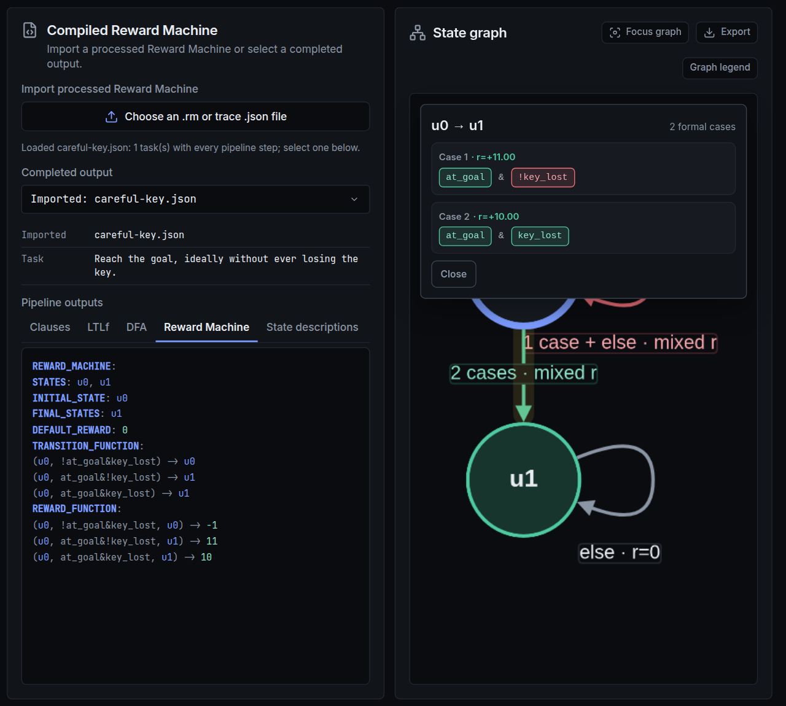
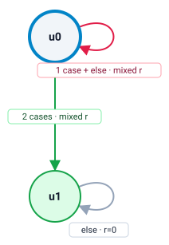
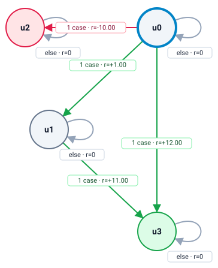
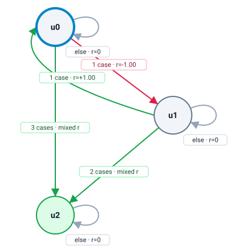

# The web page

Back to the [main page](../README.md).

A local page that runs the same pipeline as `generate-rm`, with every step on screen.

## Open it

From the root of the repository, with the Conda environment active:

```bash
PYTHONPATH=app python app/app.py
```

Then open <http://127.0.0.1:8050>. To use another port, set `PORT` before the command, for
example `PORT=8060 PYTHONPATH=app python app/app.py`.

It uses the provider set in `.env` ([engines](../app/src/engines/README.md)) and needs MONA,
like the command line. The page never asks for or shows a key.

## Use it

1. **Give the environment description.** Upload the Markdown file or paste it.
2. **Write one or more tasks.**
3. **Give one output name.** With several tasks the files are numbered, as in the command line.
4. **Run.** The critic reviews each task on its own.



The form before a run, with every output switched on. **MiniGrid labeling** and **Local state
embeddings** start switched off. Labelling needs the environment's `environment-code.md`, and
embeddings need the [local embedding server](embeddings.md).

Each finished RM is shown with its file path, its text and its graph.



**Shortcut.** Uploading a tasks file such as
`experiments/dev/arm-fm/minigrid-doorkey/tasks.json` fills the description and all its tasks.

## Follow a run

- **Steps tab.** The current task, the attempt, each stage and how long it took. Blue is
  running, green done, grey waiting or skipped, red failed.
- **Log tab.** The full log of the run.
- **Stop generation.** Stops after the current request returns. The current task is dropped
  and no file is written.



A completed run with its eight stages. The **Pipeline outputs** tabs on the right show what
the stages produced, here the clauses read from the task.

## More outputs



**State descriptions** gives one text per RM state. Keep the box ticked and open the tab of
the same name.



**Labeling** shows the Python functions written for the propositions. Give the code file, tick
**MiniGrid labeling** and open the tab after the run.

## Open a saved run



**Import processed Reward Machine** takes an `.rm` file or a run's trace `.json` from
`outputs/traces/`, with no new model call. A trace brings back the pipeline outputs, an `.rm`
file only the RM. Here a trace was loaded and one arrow clicked.

## What the graph shows

<table>
<tr valign="top">
<td><br>Reach the goal, ideally without ever losing the key.</td>
<td><br>Pick up the key, then reach the goal.</td>
<td><br>Go to the exit, and whenever the siren rings, try to turn it off.</td>
</tr>
</table>

Circles are states: a thick blue ring marks the start, green the final state (task done), red
a rejecting state (no way left to finish). Arrows are transitions, labelled with their number
of cases and reward (`mixed r` if they differ, `else` for anything not listed). Conditions are
in the RM text, or click an arrow. **Export** saves the page's graph as SVG or HTML.

## Limits

One run at a time, nothing is saved between runs, and there is no login. It is meant for one
person on their own machine.
